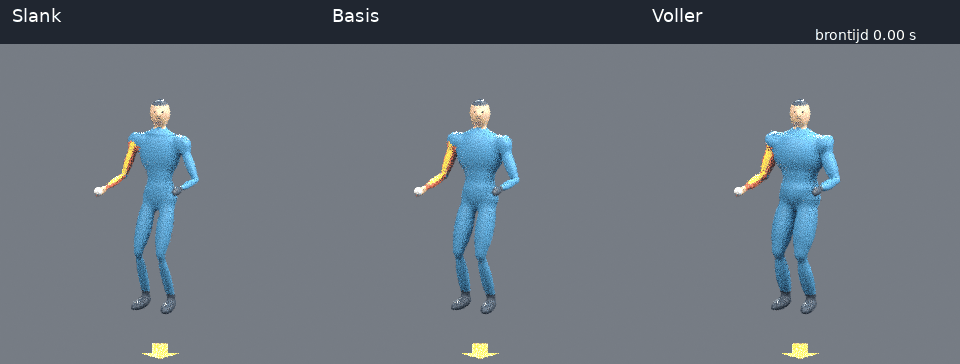

# Dezelfde worp, drie lichaamsvormen

De pitch-v2-beweging is identiek voor drie oorspronkelijke procedurele volwassen
mannequins: **slank, basis en voller**. Alleen de buitenkant verandert. Dezelfde
gewrichtscentra, segmentlengtes, rotaties, tijdstippen, camera's en huidgewichten
blijven behouden. Er worden geen menselijke assets of texturen gedownload.



## Beoordelen

- [Vergelijking van voren, viermaal vertraagd](comparison-front-slow.mp4)
- [Vergelijking van opzij, viermaal vertraagd](comparison-side-slow.mp4)
- [Vijf standen van voren](poses-front.jpg)
- [Vijf standen van opzij](poses-side.jpg)

Links staat slank, midden de bestaande basis en rechts voller. Bekijk vooral
rompdikte van opzij, bovenarmen en bovenbenen, en de schouder tijdens maximale
exorotatie. De brontijd bovenin blijft de oorspronkelijke bewegingstijd.
De beelden zijn kleine CPU-reviewrenders; oppervlakteruis is geen huidtextuur.

## Wat is veranderd?

| Parameter ten opzichte van de basis | Slank | Basis | Voller |
|---|---:|---:|---:|
| Rompbreedte | 0,86 | 1,00 | 1,13 |
| Rompdiepte | 0,78 | 1,00 | 1,42 |
| Radiale dikte ledematen | 0,82 | 1,00 | 1,22 |

Dit zijn factoren voor de procedurele oppervlaktebewerking, geen gemeten
lichaamsomtrekken. Overgangen worden met de bestaande huidgewichten gemengd;
daardoor hoeven de uiteindelijke omtrekken niet exact deze verhoudingen te hebben.
Hoofd, handen en voeten krijgen geen afzonderlijke vormbewerking; gemengde
huidgewichten kunnen bij de overgang wel een klein effect geven.

De vorm wordt in rust aangepast, na het vastleggen van de basis-huidgewichten.
Daarna vervormt hetzelfde skelet de nieuwe huid. Een dikkere romp wordt daardoor
niet opnieuw aan een andere schouderbotgroep gekoppeld. Dit houdt de eerdere
oplossing tegen de 'vleugels' onder de schouders in stand.

## Wat bewijst de controle?

[Het machineleesbare rapport](report.json) bevat de bronhash van de beweging,
de hash van de uitgangsscène, alle 51 tijdstippen en per variant de meshhash
en afwijkingen van de bottransformaties en beschermde huidregio's.
Bij iedere gerenderde stand wordt gecontroleerd dat de Blender-botten nog met
dezelfde referentie overeenkomen, en dat borstkas en beide onderarmschachten
hun vastgelegde huidbinding behouden. Een afwijking groter dan 0,1 mm-equivalent
in positie of 0,0001 in matrixelementen stopt de renderer.

Dit bewijst geen natuurlijke vet-/spierverdeling, afwezigheid van
zelfdoorsnijding of anatomische geldigheid. Ook zijn dit geen leeftijds-,
BMI- of geslachtsmodellen. Een volledige worp met hetzelfde skelet bij elke
lichaamsbouw is een gecontroleerd experiment, geen claim dat mensen met
verschillende lichaamsbouw exact hetzelfde bewegen.

De open ISB-/Movalytics-aansluiting verandert hierdoor niet. GEM-X is nog niet
op deze filmpjes uitgevoerd. Bekende modelrotaties blijven voor alle varianten
gelijk; de klinische interpretatie moet nog worden afgerond.

## Losse video's op oorspronkelijke snelheid

Deze video's hebben één persoon, één camera, geen tekst of assen, 20 beelden
per seconde en 51 beelden inclusief beide eindpunten. Brontijd = beeldnummer / 20;
bronindex in het 240-Hz-bestand = beeldnummer × 12. Het laatste beeld heeft
tijdstip 2,5 s; de videoduur inclusief dat laatste beeld is 2,55 s.

| Vorm | Voor | Zij |
|---|---|---|
| Slank | [MP4](slender-front-20fps.mp4) | [MP4](slender-side-20fps.mp4) |
| Basis | [MP4](baseline-front-20fps.mp4) | [MP4](baseline-side-20fps.mp4) |
| Voller | [MP4](fuller-front-20fps.mp4) | [MP4](fuller-side-20fps.mp4) |

Dit zijn reviewbestanden; voor snelle worpanalyse moet later met een hogere
beeldfrequentie worden gerenderd. De vroegere basisvideo's hebben 60 fps.
Gebruik de vertraagde vergelijking met drie personen niet als monoculaire invoer.

## Jong en oud als vervolgstap

Kinderen vragen om andere segmentverhoudingen, grootte en gewrichtscentra.
Oudere volwassenen vragen mogelijk om andere lichaamsvormen en houding;
leeftijd kan niet betrouwbaar worden nagebootst door alleen een mesh dunner,
kleiner of krommer te maken. Daarvoor moeten we aparte, onderbouwde parameters
kiezen. Deze eerste stap onderzoekt bewust alleen volwassen oppervlaktedikte.

## Reproduceren

Maak eerst de oorspronkelijke baseline-scène met `scripts/render_pitch.py`
uit `outputs/pitch-v2/motion.npz`, zoals in de pitch-v2-handleiding.
Gebruik voor de onderstaande stap geen reeds vervormde scène.

```bash
blender -b -t 4 --python scripts/render_body_shapes.py -- \
  --scene outputs/pitch-v2-review/pitch_review.blend \
  --data outputs/pitch-v2/motion.npz \
  --out outputs/body-shapes-review --size 320
.venv/bin/python scripts/build_body_shape_review.py \
  --renders outputs/body-shapes-review --out docs/body-shapes
```

De bronfuncties staan in `meshlearning/body_shapes.py`. Voor een nieuw opgebouwde
scène ondersteunt `scripts/render_pitch.py` ook `--body-shape slender|baseline|fuller`.
