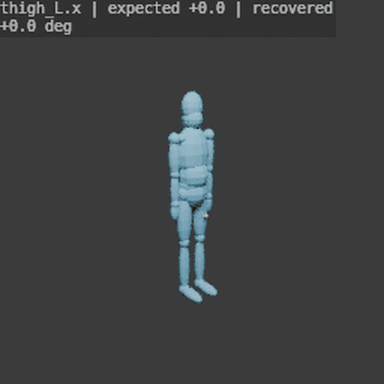
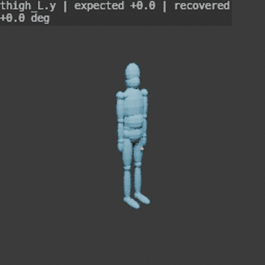
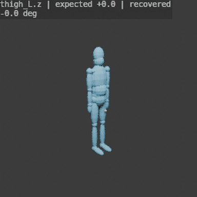

# Controlepakket: geïsoleerde bewegingen

**Dit rapport toetst rotaties, lokale assen en rustcorrectie; geen anatomische ISB-validatie.**

Definities: `engineering-axes-v2`. Rechtshandig: X rechts, Y voorwaarts, Z omhoog.
Links is negatieve X; rechts positieve X. Hoeken in graden; actieve rotaties met kolomvectoren.

- 18 segmenten, 54 technische assen.
- 1782 controles: 1782 geslaagd, 0 mislukt.
- Maximale absolute hoekfout: 2.84e-14°.
- Maximale afwijking op passieve gewrichten (matrix): 8.88e-16.
- Teststanden: 0, ±5, ±30, ±60 en ±120 graden, inclusief herhaalde nulstanden.
- Drie omstandigheden: neutraal, gedraaide ouder/wereld en gedraaide ouder met niet-neutrale rustrotaties.

## Verwacht versus berekend

Onderstaande voorbeelden gebruiken een bekende +60°-rotatie met niet-neutrale rustrotaties.
Elke technische as heeft dezelfde volledige reeks; zie de CSV voor alle controles.

| Segment/as | Positieve interpretatie (voorlopig) | Verwacht | Berekend | Fout |
|---|---|---:|---:|---:|
| pelvis.x | technical axis only; no anatomical interpretation assigned | 60° | 60.000000° | -7.1e-15° |
| pelvis.y | technical axis only; no anatomical interpretation assigned | 60° | 60.000000° | -7.1e-15° |
| pelvis.z | technical axis only; no anatomical interpretation assigned | 60° | 60.000000° | -7.1e-15° |
| trunk.x | technical axis only; no anatomical interpretation assigned | 60° | 60.000000° | 7.1e-15° |
| trunk.y | technical axis only; no anatomical interpretation assigned | 60° | 60.000000° | -7.1e-15° |
| trunk.z | technical axis only; no anatomical interpretation assigned | 60° | 60.000000° | -1.4e-14° |
| neck.x | technical axis only; no anatomical interpretation assigned | 60° | 60.000000° | 7.1e-15° |
| neck.y | technical axis only; no anatomical interpretation assigned | 60° | 60.000000° | -7.1e-15° |
| neck.z | technical axis only; no anatomical interpretation assigned | 60° | 60.000000° | -1.4e-14° |
| head.x | technical axis only; no anatomical interpretation assigned | 60° | 60.000000° | 7.1e-15° |
| head.y | technical axis only; no anatomical interpretation assigned | 60° | 60.000000° | -1.4e-14° |
| head.z | technical axis only; no anatomical interpretation assigned | 60° | 60.000000° | -1.4e-14° |
| clavicle_L.x | technical axis only; no anatomical interpretation assigned | 60° | 60.000000° | -7.1e-15° |
| clavicle_L.y | technical axis only; no anatomical interpretation assigned | 60° | 60.000000° | -7.1e-15° |
| clavicle_L.z | technical axis only; no anatomical interpretation assigned | 60° | 60.000000° | -1.4e-14° |
| upperarm_L.x | positive flexion candidate | 60° | 60.000000° | -7.1e-15° |
| upperarm_L.y | positive abduction candidate | 60° | 60.000000° | -7.1e-15° |
| upperarm_L.z | positive internal rotation candidate | 60° | 60.000000° | -1.4e-14° |
| forearm_L.x | positive elbow flexion candidate | 60° | 60.000000° | -7.1e-15° |
| forearm_L.y | technical axis only; no anatomical interpretation assigned | 60° | 60.000000° | -7.1e-15° |
| forearm_L.z | technical axis only; no anatomical interpretation assigned | 60° | 60.000000° | -7.1e-15° |
| hand_L.x | technical axis only; no anatomical interpretation assigned | 60° | 60.000000° | -7.1e-15° |
| hand_L.y | technical axis only; no anatomical interpretation assigned | 60° | 60.000000° | -1.4e-14° |
| hand_L.z | technical axis only; no anatomical interpretation assigned | 60° | 60.000000° | -1.4e-14° |
| thigh_L.x | positive flexion candidate | 60° | 60.000000° | -7.1e-15° |
| thigh_L.y | positive abduction candidate | 60° | 60.000000° | -7.1e-15° |
| thigh_L.z | positive internal rotation candidate | 60° | 60.000000° | -7.1e-15° |
| shank_L.x | positive knee flexion candidate | 60° | 60.000000° | -7.1e-15° |
| shank_L.y | technical axis only; no anatomical interpretation assigned | 60° | 60.000000° | -7.1e-15° |
| shank_L.z | technical axis only; no anatomical interpretation assigned | 60° | 60.000000° | -7.1e-15° |
| foot_L.x | positive dorsiflexion candidate | 60° | 60.000000° | -7.1e-15° |
| foot_L.y | technical axis only; no anatomical interpretation assigned | 60° | 60.000000° | -7.1e-15° |
| foot_L.z | technical axis only; no anatomical interpretation assigned | 60° | 60.000000° | -7.1e-15° |
| clavicle_R.x | technical axis only; no anatomical interpretation assigned | 60° | 60.000000° | -7.1e-15° |
| clavicle_R.y | technical axis only; no anatomical interpretation assigned | 60° | 60.000000° | -7.1e-15° |
| clavicle_R.z | technical axis only; no anatomical interpretation assigned | 60° | 60.000000° | -1.4e-14° |
| upperarm_R.x | positive flexion candidate | 60° | 60.000000° | 7.1e-15° |
| upperarm_R.y | positive abduction candidate | 60° | 60.000000° | -1.4e-14° |
| upperarm_R.z | positive internal rotation candidate | 60° | 60.000000° | -1.4e-14° |
| forearm_R.x | positive elbow flexion candidate | 60° | 60.000000° | 7.1e-15° |
| forearm_R.y | technical axis only; no anatomical interpretation assigned | 60° | 60.000000° | -7.1e-15° |
| forearm_R.z | technical axis only; no anatomical interpretation assigned | 60° | 60.000000° | -1.4e-14° |
| hand_R.x | technical axis only; no anatomical interpretation assigned | 60° | 60.000000° | -7.1e-15° |
| hand_R.y | technical axis only; no anatomical interpretation assigned | 60° | 60.000000° | -7.1e-15° |
| hand_R.z | technical axis only; no anatomical interpretation assigned | 60° | 60.000000° | -1.4e-14° |
| thigh_R.x | positive flexion candidate | 60° | 60.000000° | -7.1e-15° |
| thigh_R.y | positive abduction candidate | 60° | 60.000000° | -7.1e-15° |
| thigh_R.z | positive internal rotation candidate | 60° | 60.000000° | -7.1e-15° |
| shank_R.x | positive knee flexion candidate | 60° | 60.000000° | 7.1e-15° |
| shank_R.y | technical axis only; no anatomical interpretation assigned | 60° | 60.000000° | -7.1e-15° |
| shank_R.z | technical axis only; no anatomical interpretation assigned | 60° | 60.000000° | -7.1e-15° |
| foot_R.x | positive dorsiflexion candidate | 60° | 60.000000° | -7.1e-15° |
| foot_R.y | technical axis only; no anatomical interpretation assigned | 60° | 60.000000° | -1.4e-14° |
| foot_R.z | technical axis only; no anatomical interpretation assigned | 60° | 60.000000° | -7.1e-15° |

## Wat dit bewijst

De fixture gebruikt Rodrigues-rotaties. De terugrekening gebruikt afzonderlijke atan2-matrixformules;
zij roept de Euler-terugrekening van de demonstratie niet aan. Ouderrotaties en ruststanden worden verwijderd.
Bij een actieve beweging blijven de lokale bewegingen van alle andere gewrichten nul.
Afzonderlijke tests controleren bekende rotatiematrices, linker/rechter geometrie, fout teken,
verkeerde rustcorrectie, gecombineerde rotaties, ongeldige matrices en de ambiguïteit bij 180°.

## Wat nog niet is aangetoond

De procedurele segmentassen zijn niet uit anatomische landmarks bepaald. De klinische namen zijn
voorlopige geometrische interpretaties. 54 technische assen betekenen niet 54 vrije fysiologische DOF.
±120° is een algebraïsche stresstest; het is geen toegestaan bewegingsbereik voor elk gewricht.
Schouder is een clavicula-bovenarmproxy zonder scapula; enkel en onderarm zijn vereenvoudigd.
Er is geen test van gekoppelde klinische hoeken, huidvervorming, botsingen of beeldschattingsfouten.
GEM-X en Movalytics zijn hier niet uitgevoerd. Dit rapport beoordeelt hun nauwkeurigheid niet.

## Bestanden

- [Expliciete definities en tekenafspraken](definitions.json)
- [Alle verwachte en berekende hoeken](angle_checks.csv)
- [Machineleesbaar rapport](report.json)

## Reproduceren

```bash
python -m meshlearning.cli controls --out outputs/controls-new
python -m unittest discover -s tests -v
```

## Geïsoleerde voorbeeldbewegingen

Alleen de linkerheup beweegt lokaal; de overige gewrichten blijven lokaal
neutraal. Het gele punt is een technisch oriëntatiepunt op het bovenbeen.
De tekst in beeld geeft het kanaal, de ingestelde en de teruggerekende hoek.
De negatieve helft van elke proef is een technische test, geen ROM-advies.

### Flexie-/extensierichting



[Verwacht versus berekend per frame](hip-flexion-expected-calculated.csv)

### Abductie-/adductierichting



[Verwacht versus berekend per frame](hip-abduction-expected-calculated.csv)

### Endo-/exorotatierichting



[Verwacht versus berekend per frame](hip-rotation-expected-calculated.csv)

Voor alle gewrichten gelden de [vastgelegde definities en anatomische beperkingen](../ANGLE_DEFINITIONS.md).

Dit is een vastgelegde controle-uitvoer. Het CLI-commando genereert de rapporten;
de GIFs worden apart met de renderer gemaakt. De broncode staat in
[`meshlearning/controls.py`](../../meshlearning/controls.py).
