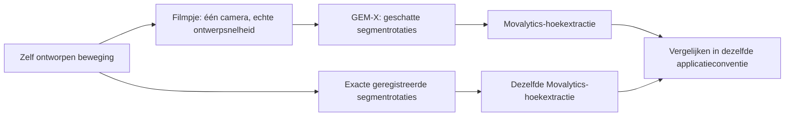
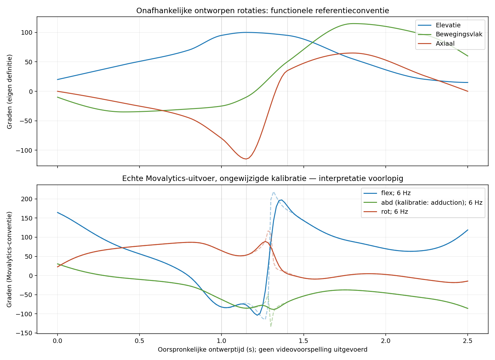

# Van bekende beweging naar Movalytics-hoeken

**De exacte pitchrotaties zijn met een registratie op de echte, vastgelegde
SOMA-template door de ongewijzigde Movalytics-kalibratie gehaald.**
Er is nog geen filmpje door GEM-X geanalyseerd. De uitkomsten blijven
voorlopig: een concreet verschil tussen invoerroutes moet met Babon worden opgehelderd.

## Je oorspronkelijke idee klopt

Het doel is inderdaad: **filmpje door de bestaande applicatie → geschatte
hoeken vergelijken met de bekende beweging**. De CPU-stap hieronder zorgt
dat beide kanten in dezelfde definitie staan.



Mijn eerdere uitleg dat de referentiehoeken nooit via dezelfde extractor mogen
worden bepaald, was te streng. De **referentierotaties** blijven onafhankelijk
van GEM-X: ze komen uit onze ontworpen beweging. Het is toegestaan beide sets
rotaties met dezelfde vastgelegde conversie te beschrijven. Dat meet de fout
van de beeldschatting in de applicatieconventie. Het bewijst niet dat die
conventie of kalibratie klinisch juist is; dat vraagt aparte anatomische validatie.
Een rotatiefout vóór de hoekextractie is daarnaast een nuttige onafhankelijke maat.

## Wat is nu echt uitgevoerd?

| Onderdeel | Resultaat |
|---|---|
| SOMA-versie | `86632764684281dc98f31ab9c4aac36a4cdbc428` |
| Officiële rig | Gedownload en SHA256 geverifieerd; circa 345 MB, niet meegeleverd |
| Segmentframes | Chest, RightArm, LeftArm en bijbehorende referentiegeometrie uit de echte template gelezen |
| Registratie | Template-gematchte conventie vastgelegd; geen gemeten epicondylaire registratie |
| Controles | Zes referentiestanden, twee wereldoriëntaties, beide schouders |
| Pitch | 151 standen op 60 Hz, passend bij de enkelvoudige invoerfilmpjes |
| Movalytics | Echte CPU-berekening met `soma_gemx_v14`, kalibratie ongewijzigd |
| Uitvoer | Ongefilterd én met de bestaande 6-Hz-filter |
| GEM-X op het filmpje | **Niet uitgevoerd**; geen NVIDIA-GPU/modelgewichten in deze omgeving ingericht |

De officiële USD-rig heeft 122 joints. Een paar niet-rigide vervormingshelpers
bevatten schaal; die worden niet als meetsegmenten gebruikt of stilzwijgend
rechtgetrokken. De benodigde Chest/Arm/ForeArm/Hips-frames zijn wel rigide.
De USD-matrices worden volgens de vastgelegde SOMA-loader getransponeerd en
via de ouderketen opgebouwd. De wereld is Y-up; de modelassen en
registratiematrices staan in [registration.json](registration.json).

De nul-twistreferentie gebruikt de geprojecteerde voorwaartse thoraxrichting
in de templatepose. Dat is een expliciete modelafspraak, geen gemeten
anatomische epicondylaire as. Interne matrixconsistentie is daarom nog geen
anatomische certificering.

## Belangrijke bevinding: twee invoerroutes verschillen

Een reproduceerbare proef houdt de bovenarm exact gelijk ten opzichte van de
thorax en draait beide samen 60° in de wereld.

| Meegeleverde route | Verandering van de aangeboden schoudermatrix |
|---|---:|
| `sources/gemx.py` → kalibratiebundel | 60°: absolute RightArm-rotatie |
| Runtime `extract_motion_matrices_per_joint` | 0°: Chest-relatieve bovenarmrotatie |

[Bekijk de uitgevoerde routecontrole](input-route-audit.json).
De bundellezer levert deze matrixwaarden vervolgens door aan de kalibratie.
Dit is een aangetoond verschil tussen de huidige meegeleverde importpaden;
het bewijst **niet** welke historische data werkelijk gebruikt zijn om de
gepubliceerde kalibratie te fitten, of welke route de werkende Babon-app gebruikt.

Ook leveren sommige eenvoudige standen met onze template-registratie
onverwachte uitkomsten op. Voor rechts, bij een zijwaarts geheven bovenarm
van 90° en ontwerp-twist 0°, rapporteert de ongewijzigde runtime bijvoorbeeld
ongeveer **132,7° flexie** en **125,7° rotatie**. Dat is een reden om
registratie-, nulstand- en invoerconventies te onderzoeken, niet om offsets
of gewichten automatisch te wijzigen.

**Open vraag voor Babon:** welke matrixrepresentatie, rustcorrectie en
voorbewerking zijn werkelijk gebruikt voor `soma_gemx_v14` en de werkende
applicatie? Absolute segmentrotaties, thorax-relatieve rotaties of een andere
gecorrigeerde representatie? De kalibratie blijft onaangeroerd totdat dit duidelijk is.

## Resultaten bekijken



De bovenste grafiek toont onze functionele ontwerpconventie; de onderste
Movalytics-kolommen. Deze worden **niet één-op-één als dezelfde hoek benoemd**.
De kolom `shoulder_abd_deg` heet in de kalibratie `adduction`; de naam alleen
bepaalt dus niet de klinische tekenafspraak.

- [Geregistreerde templateframes en aannames](registration.json)
- [Referentiestanden en daadwerkelijke Movalytics-hoeken](registration-pose-checks.csv)
- [Matrix-/wereldoriëntatiecontroles](registration-checks.json)
- [Functionele referentie en Movalytics-uitvoer naast elkaar](reference-vs-movalytics.csv)
- [Ongefilterde rechter-](raw/shoulder_R.csv) en [linkerschouder](raw/shoulder_L.csv)
- [Gefilterde rechter-](filtered_6hz/shoulder_R.csv) en [linkerschouder](filtered_6hz/shoulder_L.csv)
- [Rapport en voorlopige status](report.json) en [aantallen geldige/vergrendelde frames](sample-status.json)
- [42 uitgevoerde kalibratieproeven](calibration-probes.csv) en [proefrapport](calibration-probes-report.json)

Deze tabellen zijn **nog geen goedgekeurde trainingslabels**. Er wordt geen
GEM-X-schattingsfout of klinische MAE geclaimd: er is geen beeldschatting uitgevoerd.
De klinische betekenis moet eerst aansluiten op de feitelijke Babon-invoerroute.

## Geschikte filmpjes voor de echte beeldtest

Gebruik **één camerabeeld op de oorspronkelijke snelheid**. De vertraagde
review of drie-aanzichtenmontage is ongeschikt als standaardinvoer: die verandert
de timing of toont dezelfde persoon drie keer.

- [Voorzijde, 60 fps](pitch-input-front-60fps.mp4)
- [Zijde, 60 fps](pitch-input-side-60fps.mp4)
- [Achter/schuin, 60 fps](pitch-input-rear-60fps.mp4)

Ieder filmpje bevat 151 beelden, zonder assen/tekstoverlay. Videoframe i hoort
bij bronframe 4*i en oorspronkelijke tijd i/60. Dat verband staat ook in de
[geregistreerde referentie-NPZ](registered_rotations.npz).
De broncamera's zijn nog orthografische reviewcamera's en de mannequin is
synthetisch; herkenning door GEM-X is hiermee nog niet aangetoond.

## Reproduceren

De CPU-hoekketen werkt met Python 3.12; dit installeert geen volledige GEM-X-
CUDA-omgeving. Installeer de Babon-software alleen onder jullie toepasselijke
rechten/afspraken. Er is geen Babon-code of kalibratiebestand in deze repository gekopieerd.

```bash
python -m pip install -c configs/movalytics_cpu_constraints.txt -e '.[review,bridge]' /path/to/pinned/movalytics
python scripts/fetch_soma_rig.py --out /tmp/SOMA_template_rig.usda
python scripts/run_exact_rotation_review.py --movalytics /path/to/pinned/movalytics \
  --probes-only --out outputs/new-probes
python scripts/run_exact_rotation_review.py --movalytics /path/to/pinned/movalytics \
  --audit-input-routes --out outputs/new-route-audit
python scripts/run_exact_rotation_review.py --movalytics /path/to/pinned/movalytics \
  --rig /path/to/SOMA_template_rig.usda --motion outputs/pitch-v2/motion.npz \
  --video-samples --out outputs/new-exact-review
python -m unittest discover -s tests -v
```

De scripts controleren de Movalytics-commit, bron-/kalibratiehashes en de hash
van de officiële SOMA-rig. Een Git-LFS-pointer wordt geweigerd. Ze wijzigen
geen bronbestanden of kalibratie in de Babon-repository.

Bronnen: [Movalytics](https://github.com/Babon-Innovations-b-v/movalytics),
Kardolus et al., arXiv:2607.17639v1;
[SOMA-X, vastgelegde versie](https://github.com/NVlabs/SOMA-X/tree/86632764684281dc98f31ab9c4aac36a4cdbc428).
