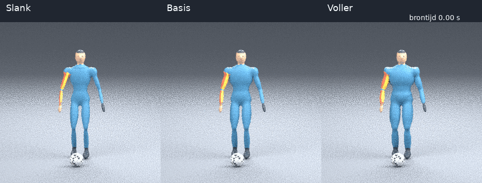
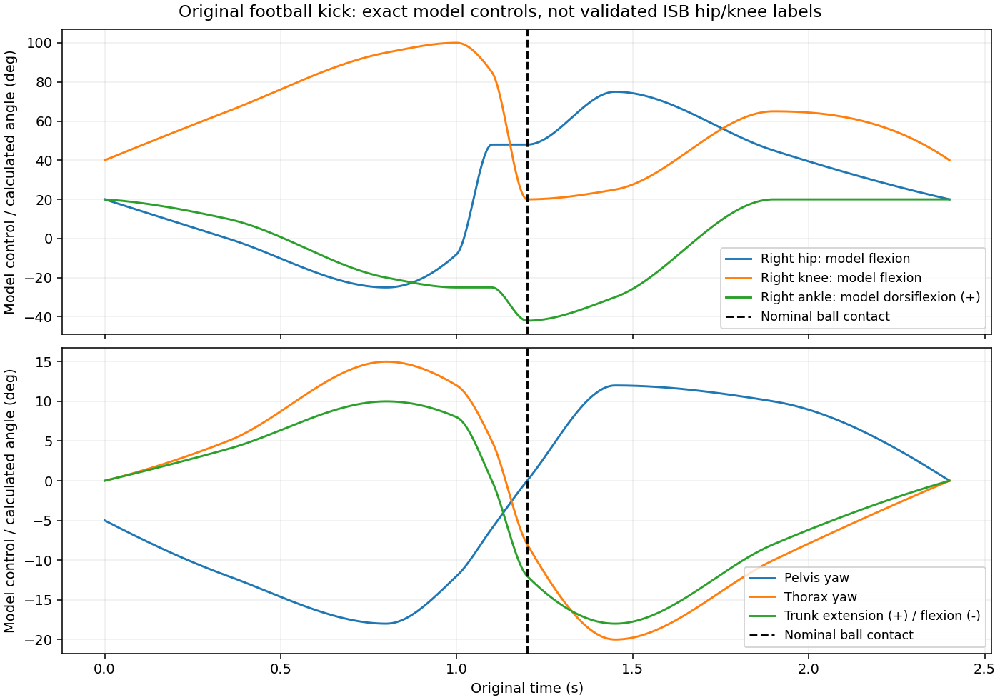

# Een voetbaltrap met drie lichaamsvormen

**Een nieuwe eigen beweging:** een rechtervoettrap vanuit stand, met een vaste
linker standvoet, achterzwaai, knie-extensie, romp-/armcoördinatie en doorzwaai.
Dezelfde beweging is weergegeven met onze slanke, basis- en vollere mesh.
Er is geen externe animatie, mocap, mensmodel of kledingasset toegevoegd.



## Bekijken en beoordelen

- [Vergelijking van opzij, viermaal vertraagd](comparison-side-slow.mp4)
- [Vergelijking van voren, viermaal vertraagd](comparison-front-slow.mp4)
- [Vijf standen van opzij](poses-side.jpg)
- [Vijf standen van voren](poses-front.jpg)

De zijaanblik laat de achterzwaai en het strekken van de knie het duidelijkst
zien. Van voren zijn de lichaamsbreedte, armbeweging en zijwaartse verplaatsing
beter zichtbaar. Links staat slank, midden basis en rechts voller.

Let vooral op de aansluiting van boven- en onderbeen bij de knie, het behoud
van de standvoet, de overgang van achterzwaai naar voorzwaai en de timing van
romp en armen. Dit is een eerste ontworpen voetbalbeweging, geen gemeten
profvoetballer. Er is nog geen aanloop.

## Wat beweegt er?

| Brontijd | Fase |
|---:|---|
| 0,00 s | Voorbereiding |
| 0,35 s | Standbeen belasten, rechtervoet los |
| 0,80 s | Achterzwaai |
| 1,00 s | Voorzwaai inzetten |
| 1,10 s | Knie strekken |
| 1,20 s | Ontworpen nominaal balcontact |
| 1,45 s | Doorzwaai |
| 1,90 s | Herstel |
| 2,40 s | Eindstand |

De rechterheup, knie en enkel zijn direct met bekende modelhoeken aangestuurd.
De voet draait mee met het onderbeen; de enkelcontrol is ten opzichte van het
onderbeen gedefinieerd en niet ten opzichte van de wereld. De
linkerenkel blijft op één wereldpositie en de linker knie wordt met twee-link-
IK bepaald. Het bekken draait en verplaatst; de romp draait deels tegengesteld
en gaat van lichte extensie naar flexie. Beide armen bewegen mee.



Deze heup-, knie- en enkelhoeken zijn **expliciete modelcontrols**, geen gevalideerde
ISB-heup-/knie-/enkelhoeken. De nieuwe geometrische schouderreferentie blijft een apart
onderdeel; deze demonstratie breidt die niet stilzwijgend uit naar de heup.
De exacte rotatiematrices van alle 22 segmenten zijn wel opgeslagen.

## De bal

De bal is een eigen procedureel gemaakte markering met straal 11 cm. Op het
gekozen tijdstip 1,20 s ligt het ontworpen teen-eindpunt op het boloppervlak.
Daarna vertrekt de bal met een ingestelde snelheid in de traprichting. Er wordt
**geen botsingskracht, impulsoverdracht of fysisch correcte balbaan berekend**.
Het is ook geen gevalideerd tijdstip van huid-/schoencontact: de schoen heeft
volume rondom het technische teen-eindpunt.

## Wat is gecontroleerd?

[De bewegingscontroles](motion-checks.json) leggen onder andere vast:

- beide boven- en onderbenen behouden hun lengte van 45 cm;
- de linker stand-enkel blijft op dezelfde plek;
- de rechterheup-, knie- en enkelcontrols komen overeen met terugberekende lokale
  rotaties; de knie wordt bovendien onafhankelijk uit de gewrichtsposities
  terugberekend;
- het rechter teen-eindpunt blijft boven het grondvlak;
- de nominale balmarkering sluit op het gekozen teen-eindpunt aan.

[Het renderrapport](report.json) koppelt de beweging via SHA256 aan de renders.
Bij iedere gerenderde stand worden de werkelijke Blender-bottransformaties
vergeleken met de brondata. Ook de beschermde borstkas en beide onderarmschachten
worden op de geëvalueerde mesh gecontroleerd. De drie lichaamsvormen gebruiken
dezelfde beweging, hetzelfde skelet, dezelfde huidgewichten en camera's.

Dit is geen volledige controle op zelfdoorsnijding van de mesh, schoen-
penetratie, dynamische balans of natuurlijke spier-/vetvervorming. De vaste
stand-enkel is een geometrische contactvoorwaarde, geen berekende steunreactie.
GEM-X en Movalytics zijn nog niet op deze filmpjes uitgevoerd.

## Losse filmpjes op oorspronkelijke snelheid

Eén persoon, één camera, zonder tekst of assen. De bal en de grondpijl zijn
wel zichtbaar. Elke video heeft 73 beelden op 30 fps, met brontijden van
0 t/m 2,4 s. Beeld i hoort bij bronframe 8 × i van het 240-Hz-bestand.
De videoduur inclusief het laatste beeld is ongeveer 2,433 s.

| Vorm | Voor | Zij |
|---|---|---|
| Slank | [MP4](slender-front-30fps.mp4) | [MP4](slender-side-30fps.mp4) |
| Basis | [MP4](baseline-front-30fps.mp4) | [MP4](baseline-side-30fps.mp4) |
| Voller | [MP4](fuller-front-30fps.mp4) | [MP4](fuller-side-30fps.mp4) |

De vertraagde vergelijkingen bevatten drie personen naast elkaar en zijn
bedoeld voor beoordeling. Gebruik voor monoculaire analyse de losse filmpjes.
Voor nauwkeurige analyse van de snelle voetbeweging is later een hogere
renderfrequentie wenselijk; de oorspronkelijke data zijn al 240 Hz.

## Brondata en opnieuw maken

- [Bronpakket met exacte beweging, controls, ontwerp en controles](football-source-data.zip)
- [Bekende en terugberekende modelhoeken per bronframe](angles.csv)
- [Ontwerp en sleutelstanden](design.json)
- [Rendercontroles en exacte videosampling](report.json)

De geometrie en beweging zijn origineel procedureel. De bestaande volwassen
oppervlakteprofielen veranderen dikte en breedte; ze vormen geen leeftijds-,
BMI- of geslachtsmodellen. De outfit is dezelfde strakke reviewkleding als
voorheen. Losse kleding en veranderde skeletverhoudingen zijn in deze versie
niet toegevoegd.

```bash
.venv/bin/python -m meshlearning.cli football-kick \
  --config configs/football_kick_v1.json --out outputs/football-new
blender -b -t 4 --python scripts/render_body_shapes.py -- \
  --scene outputs/pitch-v2-review/pitch_review.blend \
  --data outputs/football-new/motion.npz \
  --out outputs/football-renders-new --replace-motion \
  --step 8 --size 320 --samples 8
.venv/bin/python scripts/build_football_review.py \
  --renders outputs/football-renders-new \
  --motion-dir outputs/football-new --out outputs/football-review-new
```

De uitgangsscène is de oorspronkelijke eigen baseline-scène uit de pitch-v2-
handleiding, met hetzelfde rustskelet. `--replace-motion` vervangt de animatie,
zet de balmarkering klaar en behoudt mesh, rustbotten en huidgewichten. De
nieuwe animatiecurves worden in één keer gevuld; er wordt geen beweging van
het oude filmpje overgenomen. Er zijn geen nieuwe externe assets nodig.

## Daarna: kleding en lichaamsverhoudingen

Twee logische uitbreidingen zijn een strakke sportoutfit met andere kleuren/
lengtes, en afzonderlijke volwassen skeletverhoudingen zoals langere benen
of een langere romp. Bij andere segmentlengtes moeten we beweging, voetcontact,
mesh en labels opnieuw samen opbouwen; alleen het plaatje uitrekken is
onvoldoende. Leeftijdslabels vragen daarnaast om onderbouwde populatiegegevens.
