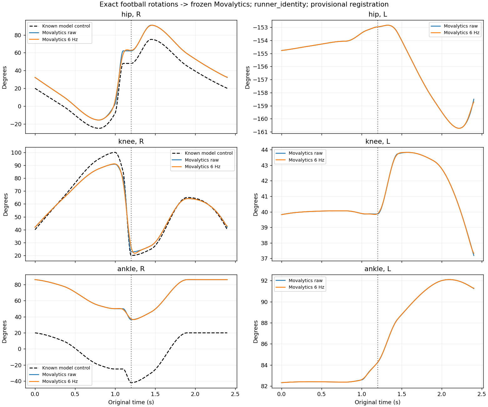
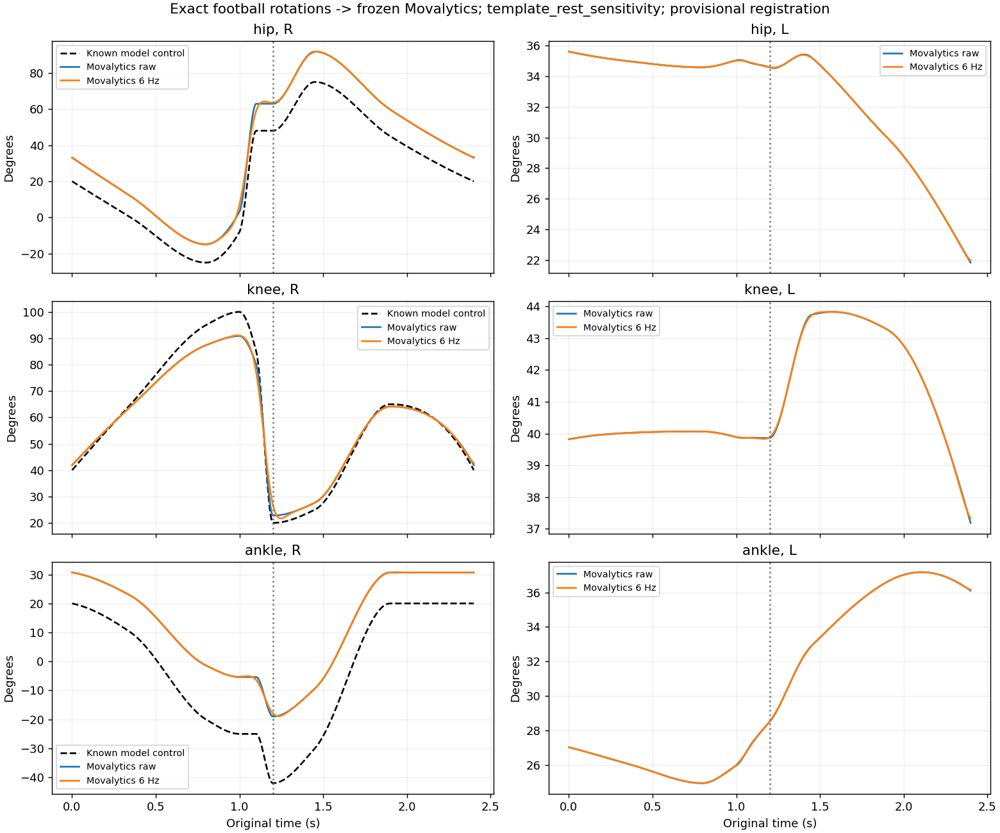

# De voetbaltrap rechtstreeks door Movalytics

**Voor de knie van het trapbeen komt de verwachting uit:** de hoek volgt onze
bekende modelbeweging veel beter dan de schouder in de eerdere proef.
De heup heeft een duidelijke verschuiving van de nulstand. De enkel hangt
sterk af van de rustconventie en is nog niet betrouwbaar aangesloten.

Dit is een controle van **exacte rotaties → hoekberekening**, zonder GEM-X.
Het filmpje is niet door een beeldherkenningsmodel geanalyseerd. De drie
lichaamsvormen hebben dezelfde skeletrotaties; deze berekening is daarom
voor alle drie dezelfde.

## Belangrijkste uitkomsten voor het rechter trapbeen

Onderstaande waarden komen uit de ongewijzigde `soma_gemx_v14`-kalibratie,
met de identiteitsrustmatrices uit de openbare GEM-X-runner, **zonder filter**.
Er is geen teken, offset, schaal of as aangepast om overeenstemming te krijgen.

| Grootheid | Bekende modelcontrol | Movalytics |
|---|---:|---:|
| Heupflexie op nominaal balcontact (1,20 s) | 48,0° | 62,1° |
| Knieflexie op nominaal balcontact | 20,0° | 22,8° |
| Grootste knieflexie in de hele beweging | 100,0° | 90,9° |
| Enkel: dorsiflexiecontrol op nominaal contact | −42,0° | +36,4° |

De enkelrij laat een groot invoer-/conventieprobleem zien, geen vastgestelde
fout van precies 78,4° in jullie werkende applicatie. Onze enkelcontrol en de
gekalibreerde klinische hoek zijn pas rechtstreeks vergelijkbaar na gevalideerde
anatomische registratie en vastgelegde nulstand/tekens.

| Gewricht | Modelbereik min–max | Movalytics min–max | Uitslag model / Movalytics | Gemiddeld absoluut verschil t.o.v. modelcontrol |
|---|---|---|---|---:|
| Heup rechts | −25,0° tot 75,0° | −15,7° tot 91,0° | 100,0° / 106,7° | 12,6° |
| Knie rechts | 20,0° tot 100,0° | 22,8° tot 90,9° | 80,0° / 68,1° | 2,8° |
| Enkel rechts | −42,0° tot 20,0° | 36,4° tot 86,2° | 62,0° / 49,8° | 70,7° |

**Dit zijn verschillen met modelcontrols, geen klinisch gevalideerde MAE.**
De knie volgt in deze proef het verloop redelijk, maar onderschat de grootste
buiging en de totale uitslag. De heup volgt het verloop met een offset en een
iets grotere uitslag. Bij de enkel is de aansluiting nog onvoldoende.



De linker kolom toont het rechter trapbeen, inclusief onze modelreferentie.
Rechts staat de uitvoer voor het linker standbeen. Voor dat been is in deze
proef geen onafhankelijke klinische referentiereeks opgesteld; er is daarom
geen kunstmatige nul- of referentielijn toegevoegd. Ook de absolute linker
uitkomsten, zoals de heupwaarde rond −155°, zijn niet klinisch gevalideerd.

## Wat doet het standaard 6-Hz-filter?

Hetzelfde bronbestand is apart met het standaardfilter doorgerekend.
Op nominaal balcontact wordt de knie dan **26,7°**, tegenover 22,8° zonder
filter en 20° modelcontrol. De snelle strekking wordt door het filter in de
tijd vermengd met de omliggende standen.

Over alle 577 bronframes is het gemiddelde knieverschil ongeveer 2,9° met
filter, tegenover 2,8° zonder filter. De grootste berekende knieflexie is met
filter 91,1°. Er is geen tijdverschuiving toegepast om een betere score te krijgen.

## Afzonderlijke rustconventiecontrole

Bij deze tweede berekening worden de echte SOMA-template-T-poseoriëntaties als
rustmatrices ingevoerd. De kalibratie blijft dezelfde. Dit is **een gevoeligheids-
controle**, geen vastgestelde vervanging voor de invoer in jullie applicatie.

| Op nominaal balcontact, ongefilterd | Modelcontrol | Runner-rust | Template-rustcontrole |
|---|---:|---:|---:|
| Heup rechts | 48,0° | 62,1° | 62,9° |
| Knie rechts | 20,0° | 22,8° | 22,8° |
| Enkel rechts | −42,0° | +36,4° | −19,0° |

De knie is vrijwel ongevoelig voor deze wissel: Leg en Shin hebben in de
gekozen template dezelfde rustoriëntatie. De heup verandert weinig. De enkel
verandert sterk: het gemiddelde verschil t.o.v. onze modelcontrol daalt van
70,7° naar 15,3°, maar daarmee is die andere rustconventie nog niet bewezen
juist voor de bestaande productiekalibratie. Er is geen nulstelling afgetrokken.



## Hoe zijn de technische frames aangesloten?

De echte, op SHA256 gecontroleerde SOMA-template wordt gelezen. Alleen de
rigide meetsegmenten Hips, Right/LeftLeg, Right/LeftShin en Right/LeftFoot
worden gebruikt. De eigen modelrotaties worden als volgt geregistreerd:

```text
R_SOMA_segment = G @ R_model_segment @ B_segment
```

G is de vaste omzetting van onze wereldassen naar de templatewereld.
B_segment volgt uit een vaste template-referentie:

- pelvis: subject right/anterior/superior;
- boven- en onderbeen: lengterichting uit opeenvolgende gewrichtscentra,
  met een voorwaartse referentie voor nul-twist;
- voet: richting Foot→ToeBase en de bovenrichting. Daarbij wordt rekening
  gehouden met onze eigen rust-teenrichting `[0, 0.18, −0.035]`; die wordt niet
  stilzwijgend vervangen door de SOMA-voetvector.

Alle matrices en aannames staan in [registration.json](registration.json).
Er zijn **geen gemeten ASIS/PSIS-, femorale epicondyl- of malleolusassen**
beschikbaar. Dit is dus een expliciete template-aansluiting, geen bewijs van
anatomisch gevalideerde beenframes. Dezelfde beperking geldt voor de interpretatie
van de gemiddelde verschillen en voor de vraag of de beenuitvoer in het algemeen
'beter' is dan de schouderuitvoer.

## Uitgevoerde controles

- Alle 577 bronframes op 240 Hz, beide benen, beide rustconventies,
  met en zonder 6-Hz-filter.
- Alle zes relatieve beenrotaties worden na registratie terugberekend naar
  onze modelrotaties. Maximale matrixafwijking: circa 9e-16.
- Alle segmenten krijgen daarnaast samen een vaste 90°-wereldrotatie.
  De beenuitvoer blijft gelijk, met maximaal verschil circa 1,5e-11°.
- De zes beengewrichten hebben in deze proef geen lockframes.
- Unittests controleren template-reconstructie, behoud van de eigen voetvector,
  omkeerbare registratie, wereldrotatie-invariantie en afwijzing van schaal in
  een meetframe. De gehele repository heeft 52 geslaagde tests.

De kalibratie en externe Movalytics-bronbestanden zijn niet aangepast.
De bundeladapter wordt niet gebruikt; dit is rechtstreeks de publieke
runtime-extractor. De bekende kwestie tussen bundel- en runtime-invoer is
hier dus geen extra uitvoeringsstap.

## Bestanden

- [Alle samenvattende waarden en controles](report.json)
- [Bereiken en gemiddelde verschillen](metrics.csv)
- [Rechterknie: model versus ruwe uitvoer](runner_identity-knee-R-comparison.csv)
- [Rechterheup: model versus ruwe uitvoer](runner_identity-hip-R-comparison.csv)
- [Rechterenkel: model versus ruwe uitvoer](runner_identity-ankle-R-comparison.csv)
- [Alle ongefilterde gewrichts-CSV's](runner_identity/raw)
- [Alle gefilterde gewrichts-CSV's](runner_identity/filtered_6hz)
- [Exacte geregistreerde rotaties](registered-leg-rotations.npz)
- [Het bijbehorende filmpje en originele bronpakket](../football-kick/README.md)

Het geregistreerde NPZ bevat 577 bronframes op 240 Hz. Dit is de tijdsbasis
voor de berekening, niet de 30 fps van het reviewfilmpje. Er worden geen
SOMA-mesh, Babon-code of kalibratiebestanden meegeleverd.

## Reproduceren

```bash
.venv/bin/python scripts/check_football_movalytics.py \
  --movalytics /tmp/movalytics-review \
  --rig /tmp/soma-pinned-rig.usda \
  --motion-dir outputs/football-kick-v1-reviewed \
  --out outputs/football-movalytics-new
```

Movalytics is vastgezet op commit `887de80c8966c1afcd35c5c685b8c59625bf6682`.
De kalibratiehash en bronhash worden gecontroleerd. Het bronpakket van de
voetbaltrap kan in een andere nieuwe map worden uitgepakt en als `--motion-dir`
worden gebruikt. Er is geen GPU nodig voor deze exacte-rotatiecontrole.

**Vervolg:** de knie is een bruikbaar eerste controlekanaal voor een echte
video-analyse. Voor de heup moeten we de absolute nulstand en anatomische
frame-aansluiting verifiëren; voor de enkel is die verificatie noodzakelijk
voordat we de uitkomst als referentie of foutmaat gebruiken.
