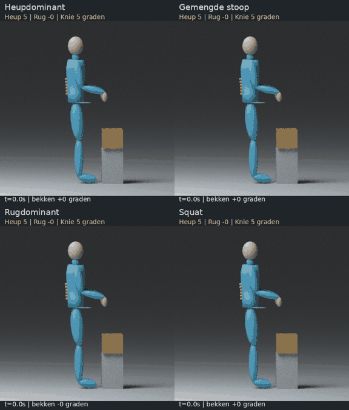

# Tilbeweging: variatie tussen heup, lage rug en knieën

Vier **zelf ontworpen** bewegingen met dezelfde doos, voetplaatsing en onderste greephoogte. De figuur pakt de doos op, tilt hem op, zet hem terug en komt zonder doos overeind. De beweging duurt zes seconden. Er zijn geen externe bewegingsbestanden, menselijke meshes of texturen gebruikt.



[Open het vergelijkingsfilmpje](lifting-comparison.mp4) · [Onderste stand van opzij](bottom-side.jpg) · [Onderste stand schuin van voren](bottom-oblique.jpg) · [Hoekcurven](angles.png) · [Brondata downloaden](lifting-source-data.zip)

## Wat vergelijken we?

De handen bereiken bij alle varianten dezelfde greephoogte van **65 cm**. De doos staat daarom op een verhoging. Dit is een eerste gecontroleerde vergelijking; nog geen tilbeweging vanaf de vloer. De voeten blijven vast staan. De armen worden naar de handposities berekend, met constante bovenarm- en onderarmlengten.

| Variant | Heupflexie | Relatieve rugflexie | Knieflexie | Bekkenkanteling |
|---|---:|---:|---:|---:|
| Heupdominant | 85° | 5° | 25° | 65° voorover |
| Gemengde stoop | 65° | 30° | 33° | 40° voorover |
| Rugdominant | 37° | 60° | 65° | 8° achterover |
| Squat | 80° | 10° | 95° | 15° voorover |

Dit zijn de **onderste standen**, niet het verschil tussen minimum en maximum tijdens de hele beweging. De beginstand heeft 5° heup- en knieflexie; de overige beginhoeken zijn nul. De waarden zijn doelbewust verschillende modelinstellingen, geen normen of aanbevelingen voor tiltechniek.

De heupdominante variant houdt de lage rug relatief vlak terwijl het bekken sterk voorover kantelt. De rugdominante variant combineert een achterovergekanteld bekken met veel relatieve rugflexie. **Ook dan blijft de heup in flexie:** de bovenbenen staan immers eveneens gekanteld. Bekkenkanteling in de ruimte en heupflexie ten opzichte van het bovenbeen zijn verschillende grootheden. De squat heeft hier vrijwel evenveel heupflexie als de heupdominante variant, maar aanzienlijk meer knieflexie en een rechtere bovenromp.

## Wat is aan het model veranderd?

Het eerdere pitch-/voetbalmodel had één star rompsegment. Voor dit experiment is een **afzonderlijk model** gemaakt met een bekken, vijf buigbare lage-ruglinks en een bovenromp. Een doorlopende rompmesh volgt die links. De eerdere bewegingen en hun rig zijn niet gewijzigd.

De oranje punten laten de kromming aan de achterzijde zien; het groene lijntje geeft de voorwaartse richting van het bekken aan. Dit zijn **reviewhulpmiddelen**, geen gemeten anatomische landmarks. De losse filmpjes bevatten deze hulpmiddelen ook.

De vijf lage-ruglinks krijgen elk een vijfde van de totale relatieve buiging. Dat maakt rugbuiging zichtbaar en controleerbaar. Het is geen model van de afzonderlijke L1–S1-gewrichten. De rechte modelnulstand bevat nog geen anatomische lordose; 5° rugflexie betekent hier dus vrijwel vlak, niet een gevalideerde absolute lumbale kromming.

## Hoekdefinities en controles

Modelassen: X naar rechts, Y naar voren, Z omhoog. Alles beweegt in het sagittale vlak; rotaties om de overige assen zijn nul.

- **Bekkenkanteling:** oriëntatie van het bekken ten opzichte van de wereld. Positief is voorover, negatief achterover.
- **Heupflexie:** relatieve rotatie van bovenbeen ten opzichte van bekken. Beide zijden voeren dezelfde beweging uit.
- **Knieflexie:** relatieve rotatie van onderbeen ten opzichte van bovenbeen, positief bij buigen.
- **Rugflexie:** relatieve rotatie van bovenromp ten opzichte van bekken. Positief betekent meer vooroverbuiging van de bovenromp dan van het bekken.
- **Bovenrompkanteling:** bekkenkanteling plus relatieve rugflexie. Dit is geen extra gewrichtshoek.

De matrices worden teruggerekend naar heup-, knie- en rughoeken en vergeleken met de ingestelde waarden. De maximale afwijking bedraagt minder dan **3 × 10⁻¹⁴°**. Linklengten blijven constant binnen **4 × 10⁻¹⁶ m**. Aanvullende tests controleren heup-, knie- en rughoeken vanuit segmentrichtingen, voetfixatie, armlengten, de verschillende strategieën en continuïteit bij de faseovergangen. Dat verifieert de implementatie van de modeldefinities; het valideert niet de anatomie of een klinische meetmethode.

De doos volgt de handen alleen tussen vastpakken en terugzetten. Daarbuiten staat hij op de verhoging. Massa, spierkrachten, dynamisch evenwicht en weefselbelasting zijn niet gesimuleerd. Er is geen volledige botsingscontrole van alle oppervlakken.

**Dit pakket is nog niet door GEM-X of Movalytics gegaan.** De hoeken zijn exacte geometrische modelreferenties en zijn nog niet als ISB-/Movalytics-hoeken geregistreerd. Het model heeft meer rompsegmenten dan onze vorige rig; de bestaande registratie mag daarvoor niet stilzwijgend worden hergebruikt.

## Filmpjes en data

- [Heupdominant](hip_hinge.mp4) · [Gemengde stoop](mixed_stoop.mp4) · [Rugdominant](lumbar_dominant.mp4) · [Squat](squat.mp4)
- Hoekdata: [heupdominant](hip_hinge-angles.csv), [stoop](mixed_stoop-angles.csv), [rugdominant](lumbar_dominant-angles.csv), [squat](squat-angles.csv).
- [Numerieke controles](checks.json) · [Framekoppeling en bronhashes](manifest.json).
- [Bronbundel](lifting-source-data.zip): per variant `motion.npz` en `angles.csv`, plus het gezamenlijke rapport.

Elke NPZ bevat 361 samples op 60 Hz, segmentnamen, ouders, wereldposities, eindpunten, absolute rotatiematrices en de hoogte van de doosgreep. De horizontale doospositie volgt tijdens vastpakken de hand; daarbuiten is Y = 0,40 m. Het dooscentrum ligt 11 cm onder de greep. De bronas X is rechts en de eenheid is meter. De bron kan zonder Blender worden uitgelezen.

De review toont iedere zesde bronframe: **10 beelden per seconde op oorspronkelijke snelheid**, zonder versnelling. Videoframe i correspondeert met bronframe 6i op tijd i/10 s. Het laatste bronframe is t = 6,0 s; met de laatste beeldduur is de video 6,1 s lang. De GIF heeft dezelfde timing. Dit is een eerste geometrische demonstratie met een eenvoudige mannequin; er wordt nog geen populatievariatie of biomechanische juistheid geclaimd.

## Reproduceren

Vanuit de repository, met de bestaande Python-reviewomgeving en Blender:

```bash
.venv/bin/python -m meshlearning.cli lifting --out outputs/lifting-new
blender -b -t 4 --python scripts/render_lifting.py -- --data outputs/lifting-new --out outputs/lifting-new-preview --preview
blender -b -t 4 --python scripts/render_lifting.py -- --data outputs/lifting-new --out outputs/lifting-new-renders
.venv/bin/python scripts/build_lifting_review.py --data outputs/lifting-new --renders outputs/lifting-new-renders --preview outputs/lifting-new-preview --out outputs/lifting-new-review
```

Gebruik nieuwe uitvoermappen om eerdere resultaten te bewaren. De generator gebruikt alleen NumPy; reviewbouw gebruikt de bestaande review-extra's, Blender en ffmpeg. Renderbronhashes worden bij de reviewbouw gecontroleerd.
