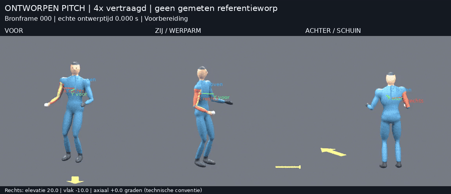
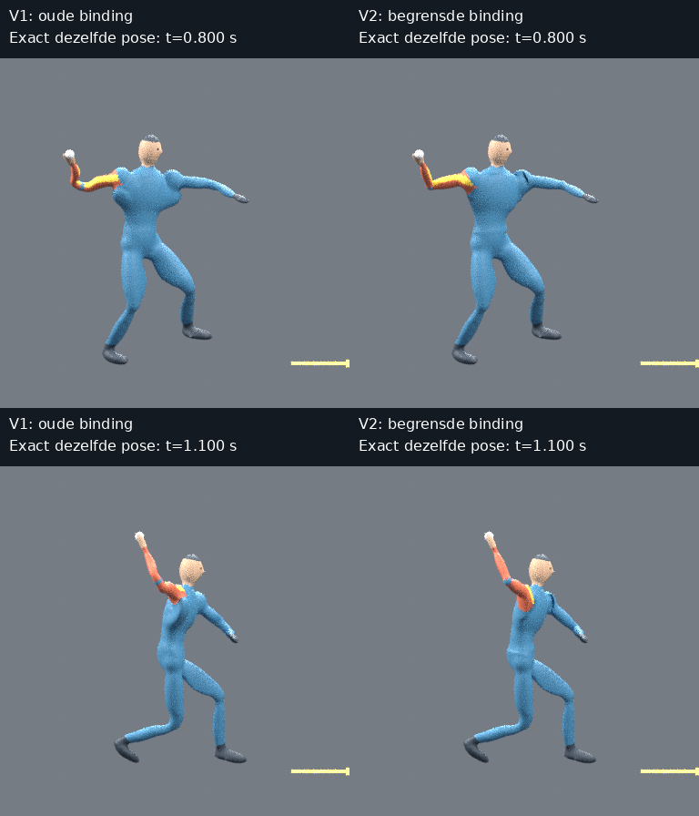
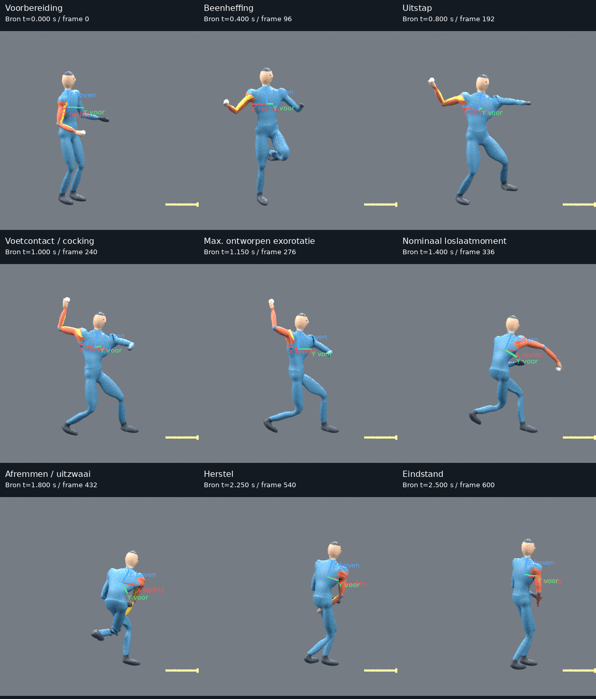
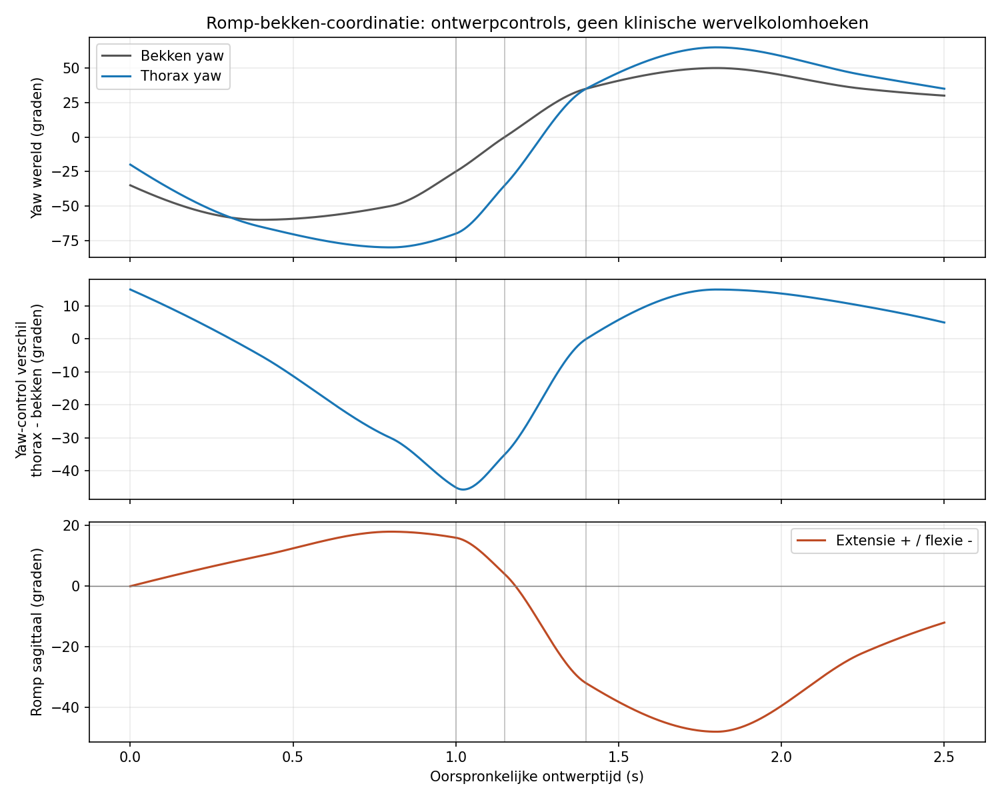
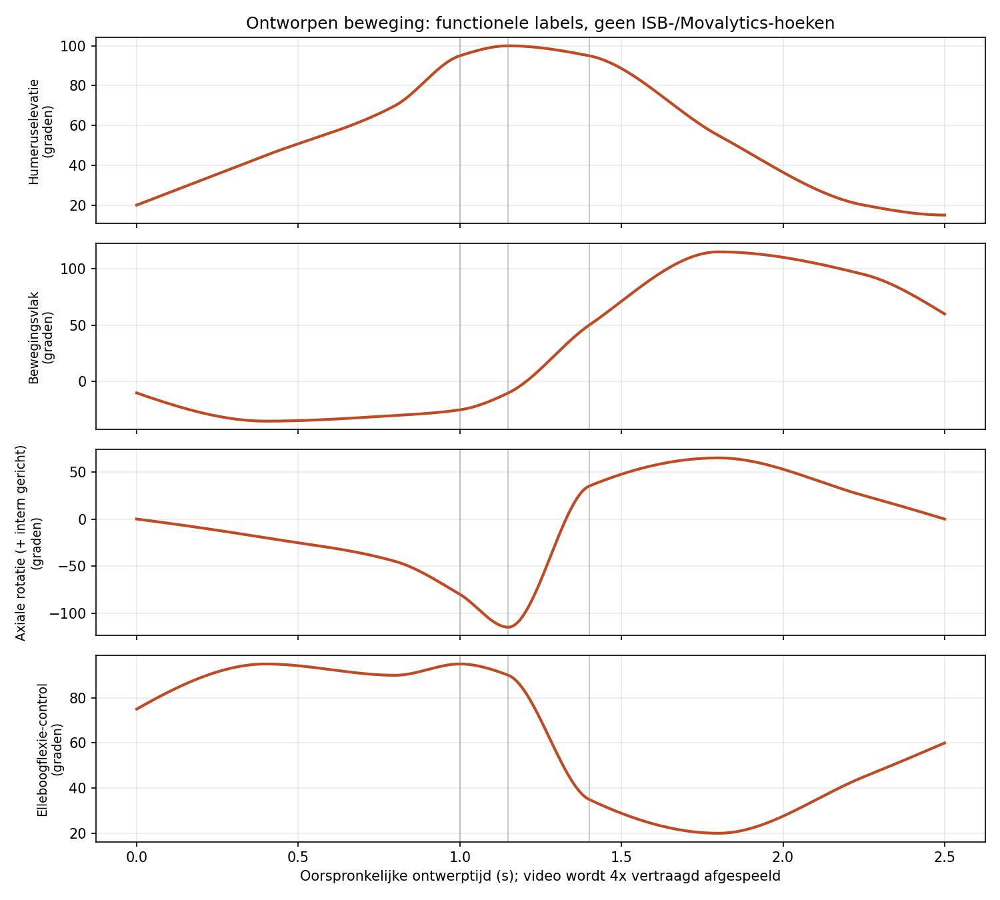
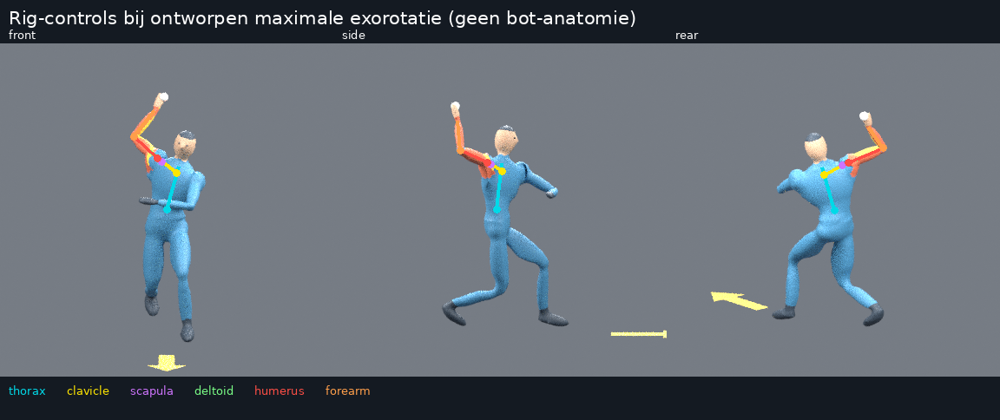

# Pitch v2 — vervorming, timing en romp-armcoördinatie

**[Vorige versie bekijken](../pitch/README.md)** ·
**[Frame-aansluiting op ISB/Movalytics](FRAME_ALIGNMENT.md)**

## De aangepaste worp



De beelden worden 4× vertraagd afgespeeld. De bronbeweging duurt 2,5 s.
De rode, groene en blauwe pijlen op de borst zijn respectievelijk rechts,
voorwaarts en omhoog in het thoraxmodel. Ze draaien met de romp mee.

- [Vertraagd, drie aanzichten samen](pitch-slow-3views.mp4)
- [Oorspronkelijke ontwerpsnelheid](pitch-real-time.mp4)
- [Voor](pitch-slow-front.mp4), [zij](pitch-slow-side.mp4), [achter/schuin](pitch-slow-rear.mp4)

Voor een MP4 zonder GitHub-videospeler: kies **View raw / Download raw file**.

## Wat is er veranderd?

| Punt | V1 | V2 |
|---|---|---|
| Romp/oksels | Nabijgelegen armbotten konden rompvertices meetrekken | Beschermde borstregio en begrensde schouderovergang |
| Onderarm | Invloeden van meerdere botten over een groot deel van de arm | Onderarmschacht volgt alleen de onderarm; menging alleen rond gewrichten |
| Max. exorotatie → nominaal loslaten | 75 ms; axiale ontwerpcontrol -135° → +60° | 250 ms; axiale ontwerpcontrol -115° → +35° |
| Romp | Yaw-ontwerpbereik 115°; maximale extensie-control +5° | Yaw-ontwerpbereik 145°; maximale extensie-control +18° |
| Review | Geen bewegend thoraxassenstelsel | Bewegende assen, apart rompdiagram en expliciet framecontract |

Dit zijn ontwerpkeuzes, geen gemeten pitchwaarden. De grotere/tragere beweging
is bedoeld als een beter beoordeelbare referentie, niet als gecertificeerde
normale of optimale werptechniek.

## Vervorming vergelijken bij exact dezelfde pose



Hier is de **oude V1-beweging onveranderd** opnieuw gerenderd met de nieuwe
binding. Camera, pose en geometrie zijn gelijk; de huidgewichten verschillen.
Daarmee wordt het effect van de vervormingscorrectie niet verward met de
nieuwe rompstand of timing. Vooral de zijaanzichten tonen de afgenomen
'vleugel' onder de schouder en de rechtere onderarm.

De beschermde romp en de onderarmschachten zijn ook op de werkelijk vervormde
Blender-vertices vóór de laatste subdivision-verfijning gecontroleerd, niet
alleen op de botmatrices. Dit garandeert
geen perfecte schouder-/okselvorm of afwezigheid van alle huidartefacten.

## Worp en rompactie beoordelen



Let op de extensie vóór maximale exorotatie, de rotatie van bekken en romp,
en de overgang naar vooroverbuigen. De tijdlabels zijn oorspronkelijke
ontwerptijden; de afspeeltijd is viermaal zo lang. Fasebeelden gebruiken het
dichtstbijzijnde gerenderde frame en vermelden de werkelijke brontijd.



De grafiek toont ontwerpcontrols. Het verschil tussen thorax- en bekken-yaw
is geen zelfstandig gevalideerde klinische wervelkolomhoek.



Verticale lijnen: voetcontact 1,000 s, ontworpen maximale exorotatie 1,150 s,
nominaal loslaatmoment 1,400 s. De assen van deze grafiek zijn nog de functionele
ontwerpconventie. De afzonderlijke virtuele-landmark-YXY-kolommen en hun
betekenis staan in [de frame-aansluiting](FRAME_ALIGNMENT.md).

## Rig, cijfers en bronbestanden



- [Hoeken en rompcontrols per bronframe](angles.csv)
- [Ontwerpkeyframes](design.json)
- [Generatiecontroles](report.json) en [render-/oppervlaktecontroles](render-checks.json)
- [Interfacecontract met Movalytics en openstaande registraties](frame-contract.json)
- [601-frame controle van de virtuele landmarkrepresentatie](frame-proxy-checks.json)
- [Timing en parameterveranderingssnelheid V1/V2](timing-comparison.json)
- [Blender-scène en brondata downloaden](pitch-source-data.zip)

De ZIP bevat de aangepaste rig, de volledige bronstanden op 240 Hz, ontwerpdata
en hoektabellen. Geen externe menselijke assets of bewegingsregistratie zijn gebruikt.

## Wat nog niet is aangetoond

De rig en lichaamsvorm zijn procedureel en gestileerd; clavicula- en scapulacontroles
zijn aannames. Camera's zijn orthografisch en de grond heeft geen realistische
contactschaduw. Balans, kracht, botsingsvrijheid en anatomische juistheid zijn
niet gecertificeerd. De beweging is geen registratie van een echte pitcher.

De framekoppeling is nu wiskundig vastgelegd en getest, maar daadwerkelijke
SOMA-registraties ontbreken nog. Er is geen GEM-X-inferentie, Movalytics-analyse
of modeltraining uitgevoerd; dit is nog geen klinische gouden standaard.

## Reproduceren

```bash
python -m pip install -e '.[review]'
python -m meshlearning.cli pitch --config configs/pitch_v2.json --out outputs/my-pitch-v2
blender --background --threads 4 --python-exit-code 1 --python scripts/render_pitch.py -- \
  --data outputs/my-pitch-v2/motion.npz --out outputs/my-pitch-v2-renders --size 384 --samples 8
python scripts/build_pitch_review.py --motion outputs/my-pitch-v2 \
  --renders outputs/my-pitch-v2-renders --out outputs/my-pitch-v2-package
python -m unittest discover -s tests -v
```

Gebruik nieuwe uitvoermappen. Het bronpad voor een optionele frame-audit is
expliciet, bijvoorbeeld `python scripts/audit_frame_contract.py --movalytics
/path/to/movalytics --out outputs/new-frame-contract.json`. Die audit leest
alleen en verandert de Babon-repository niet.

Geef feedback bij voorkeur als **fase/tijd + aanzicht + wat je ziet**.
Beoordeel vooral of de romp natuurlijk meedoet, de schoudervorm rond 1,15 s
geloofwaardig blijft en de overgang naar endorotatie nu voldoende geleidelijk oogt.
