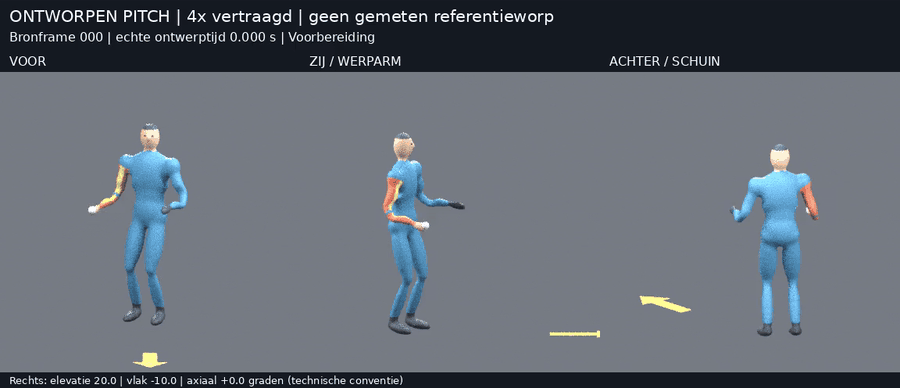
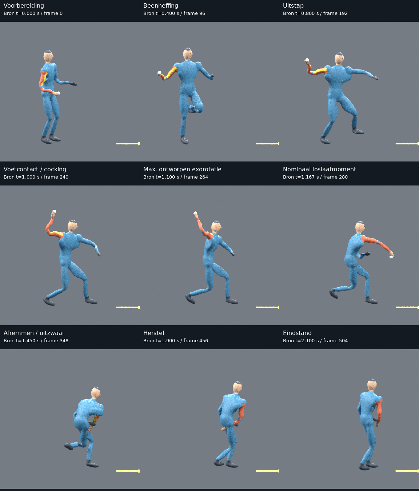
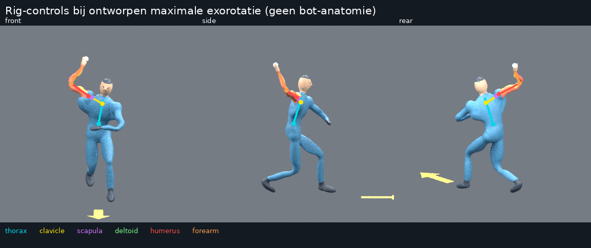
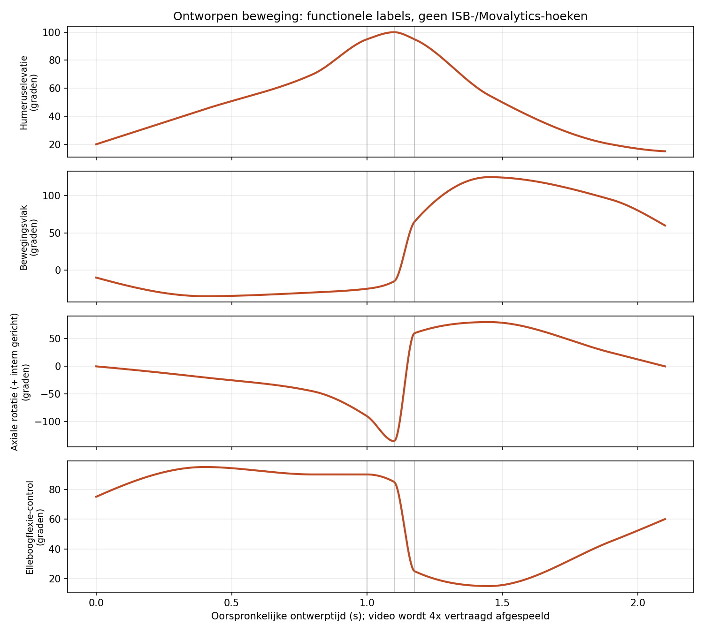

# Ontworpen baseball pitch — eerste beoordeling

**Dit is de historische V1-review. [Bekijk de aangepaste V2](../pitch-v2/README.md).**

De oorspronkelijke V1-rendercode staat op commit `d81b713ae021d81286e90f6e43224ed7292540f7`.
De huidige renderer gebruikt de nieuwe begrensde binding.

**Een eigen ontworpen, rechtshandige sportieve worp. Geen bewegingsregistratie
van een echte pitcher, geen anatomisch gevalideerde gouden standaard.**
Deze versie is bedoeld om samen de beweging, schoudervorm en labels te beoordelen
voordat we trainingsvarianten maken.

## Begin hier



De drie beelden tonen dezelfde bronframes. De oranje arm is de werparm; de
gele streep helpt axiale rotatie zichtbaar te maken. De grondpijl geeft de
beoogde werprichting aan. Het witte balletje is alleen een bezitsmarkering tot
het nominale loslaatmoment; er wordt geen balvlucht geanalyseerd.

- [Vertraagd, drie aanzichten samen — MP4](pitch-slow-3views.mp4)
- [Oorspronkelijke ontwerpsnelheid — MP4](pitch-real-time.mp4)
- [Voorzijde](pitch-slow-front.mp4), [werparmzijde](pitch-slow-side.mp4), [achter/schuin](pitch-slow-rear.mp4)

Als GitHub geen videospeler toont: kies **View raw / Download raw file**.
De GIF hierboven is rechtstreeks in deze pagina te bekijken.

## Beoordeel de worpfasen



Elke afbeelding vermeldt de werkelijke brontijd. Een fasebeeld gebruikt het
dichtstbijzijnde gerenderde frame; het is niet ongemerkt als een exact
keyframe gelabeld. Het nominale loslaatmoment is bijvoorbeeld 1,175 s;
de contact sheet toont de dichtstbijzijnde beschikbare render.

| Moment | Waar vooral naar kijken |
|---|---|
| Beenheffing en uitstap | Oogt de gewichtsverplaatsing aannemelijk? Is de stand van knie en steunvoet geloofwaardig? |
| Voetcontact / voorbereiding | Komen bekken, romp en arm samenhangend in de werppositie? |
| Ontworpen maximale exorotatie | Zijn elleboogpositie en onderarmrichting herkenbaar? Blijft de schouder/oksel geloofwaardig? |
| Versnelling en loslaatmoment | Voelt de overgang te abrupt of te mechanisch? Past de armrichting bij de bedoelde worp? |
| Afremmen en uitzwaai | Beweegt de arm geloofwaardig over het lichaam? Gaan hand, arm of benen door het lichaam heen? |

De reviewcamera’s zijn orthografisch om vorm en houding goed te vergelijken;
ze simuleren nog geen echte lens. Het egale studiovlak heeft geen realistische
contactschaduw. Daardoor kan contact met de grond optisch onduidelijk zijn.
Dit zijn beoordelingsbeelden, nog geen geschikte monoculaire trainingsdataset.

Deze versie modelleert beweging, geen werpdynamica. Bereikbare beenposities
bewijzen geen balans, grondreactiekrachten, contact of natuurlijke coördinatie.

## Technisch gecontroleerd

- 20 bestaande en nieuwe tests slagen.
- 505 bronstanden op 240 Hz; 127 gerenderde standen per aanzicht.
- De drie aanzichten gebruiken exact dezelfde bronframes.
- De Blender-rig is tegen de geëxporteerde segmenttransformaties gecontroleerd.
- Videoframeaantallen en afspeelsnelheden zijn met FFprobe gecontroleerd.

Dit zijn technische consistentiecontroles, geen validatie van natuurlijkheid.

## Schouderketen zichtbaar maken



Cyaan: thorax; geel: claviculacontrol; paars: scapulacontrol; groen:
vervormingshelper; rood: humerus; oranje: onderarm. De getekende lijnen zijn
**rig-controls, geen anatomische botcontouren**. De scapulacontrol is een
vereenvoudigde koppeling en bevat geen afzonderlijke anatomische schouderbladmesh.

De lichaamsvorm is nu aaneengesloten en skinned, met volumebehoudende vervorming.
Hij is volledig procedureel gemaakt; er zijn geen gedownloade menselijke meshes,
texturen of animaties gebruikt. Dat maakt hem nog geen gevalideerd mensmodel:
spieren, huidplooien, gewrichtscentra en populatievariatie zijn vereenvoudigd.

## Zelf de rig en bronstanden bekijken

[Download de Blender-scène en brondata](pitch-source-data.zip) via **Download raw file**.
De ZIP bevat de volledige geanimeerde scène, 240-Hz-segmentstanden, ontwerpkeyframes,
hoektabellen en een korte toelichting. Open `pitch_review.blend` met Blender 4.3.2
of een geschikte nieuwere versie. De scène staat op bronframe 265, bij de
ontworpen maximale exorotatie. De rig is meegeleverd om te inspecteren;
clavicula- en scapulacontroles zijn geen afzonderlijk gevalideerde anatomie.
Er is geen GPU nodig om de rig in de viewport te bekijken.

## Hoeken bekijken



**Deze curven zijn eigen functionele ontwerp-/referentielabels. Het zijn nog
geen ISB-gevalideerde hoeken en geen resultaten uit Movalytics.**

De drie verticale lijnen markeren voetcontact (1,000 s), de ontworpen maximale
exorotatie (1,100 s) en het nominale loslaatmoment (1,175 s).

- [Exacte definitie, tekens en beperkingen](ANGLE_DEFINITION.md)
- [Hoeken per bronframe](angles.csv)
- [Ontwerpkeyframes en timing](design.json)
- [Numerieke generatiecontroles](report.json)
- [Synchronisatie- en rig/exportcontroles](render-checks.json)

Een fout rond numerieke afronding bij het terugrekenen toont dat het beeldrig
en de technische labels met elkaar overeenkomen. Het bewijst geen anatomische
juistheid of voorspellende nauwkeurigheid. GEM-X, Movalytics en training zijn
in deze demonstratie niet uitgevoerd.

## Reproduceren

Vanuit de repository, met Blender 4.3.2 en FFmpeg op PATH:

```bash
python -m pip install -e '.[review]'
python -m meshlearning.cli pitch --config configs/pitch_v1.json --out outputs/my-pitch
blender --background --threads 2 --python-exit-code 1 --python scripts/render_pitch.py -- \
  --data outputs/my-pitch/motion.npz --out outputs/my-pitch-renders --size 384 --samples 8
python scripts/build_pitch_review.py --motion outputs/my-pitch \
  --renders outputs/my-pitch-renders --out outputs/my-pitch-review
python -m unittest discover -s tests -v
```

Gebruik nieuwe uitvoermappen; reviewbestanden worden niet stilzwijgend
overschreven. De Blender-scène met de geanimeerde rig staat lokaal als
`outputs/my-pitch-renders/pitch_review.blend`; bronrotaties en posities staan
in `outputs/my-pitch/motion.npz`.

## Wat is een nuttige volgende reactie?

Noem bij voorkeur **fase/tijd + aanzicht + wat onnatuurlijk lijkt**.
Bijvoorbeeld: “rond 1,10 s, zijaanzicht: de elleboog staat te laag” of
“na het loslaatmoment loopt de arm door de romp”. Daarmee kunnen we de
bewegingsopbouw en vervorming gericht verbeteren, vóór we variatie toevoegen.
