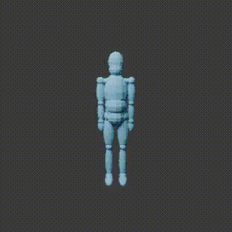

# Eerste bewegingsvoorbeeld

Dit is een eerste technische demonstratie van een procedureel lichaam met
18 segmenten. Dezelfde beweging is vanuit twee camera's gerenderd.

- [Filmpje van voren (MP4)](front.mp4)
- [Filmpje schuin van voren (MP4)](oblique.mp4)

De filmpjes bevatten elk 12 frames bij 12 beelden per seconde (1 seconde).
De GIF herhaalt de beweging. Voor de MP4 kun je op GitHub **View raw** of
**Download raw file** gebruiken als er geen videospeler verschijnt.

Dit is een schematische technische controle, geen realistische avatar en geen
anatomisch gevalideerde gouden standaard. ISB-validatie, SOMA/GEM-X-integratie
en Movalytics-analyse zijn nog niet uitgevoerd. Geen externe menselijke meshes
of texturen zijn gebruikt.
