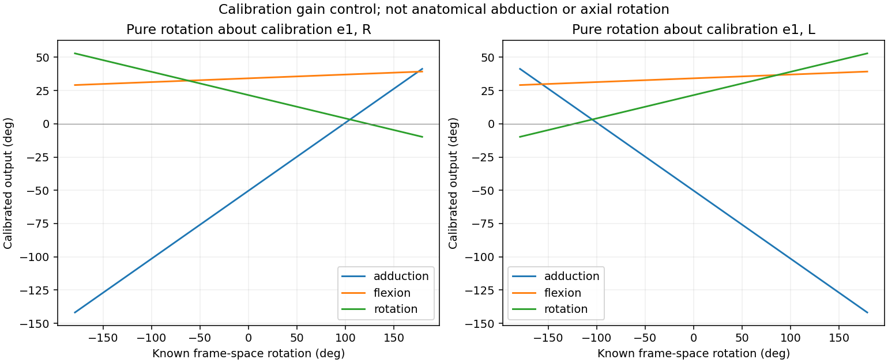

# Schouderdiagnose: aantoonbare kalibratiebegrenzing

**Er is een concrete beperking in de openbare `soma_gemx_v14`-kalibratie gevonden.**
Het ongefilterde abductie-/adductiekanaal kan voor geen enkele rotatiematrix
buiten ongeveer **−150,4° tot +49,8°** komen. Dat volgt uit de gewichten,
offset en gebruikte ontleding; het hangt niet af van onze mesh, camera,
SOMA-template of anatomische registratie.

Dit bewijst een beperking voor het gewenste volledige schouderbereik in deze
publieke versie. Het is geen volledige reconstructie van de gemelde applicatie-
fout: de werkende applicatie kan een andere versie, kalibratie of aanvullende
nulstelling/tekenomzetting gebruiken. We hebben daarvan geen ruwe uitvoer.
Een geschatte waarneming rond 53° is niet door deze proef exact verklaard.

## 1. Wat doet de kalibratie?

De rechter `abd`-uitvoer wordt berekend als:

```text
abd = 0,511726 × c0 − 0,002607 × c1 − 0,051952 × c2 − 50,288367
```

`c0`, `c1` en `c2` zijn ontledingscomponenten, **nog geen anatomische
abductie, flexie en rotatie**. Links wordt het teken van de gewogen som
omgekeerd; de offset blijft hetzelfde.

De component `c0` heeft bereik −180° tot +180°. De twee andere componenten
zijn projecties van een swing-rotatievector met lengte maximaal 180°.
Zelfs als we heel ruim aannemen dat alle drie de componenten onafhankelijk
elk ±180° kunnen zijn, geeft de formule slechts −152,2° tot +51,6°.
Rekening houdend met de gebruikte assen wordt de bovengrens strenger:
−150,376845° tot +49,800111°.

**Een directe waarde +160° én een directe waarde −160° zijn dus onmogelijk
in dit ongefilterde kanaal.** Een tekenomkering alleen lost dat niet op.
Dit is een bereikbegrenzing van de formule, geen expliciete clip-instructie.
Een verandering van 160° ten opzichte van een andere uitgangswaarde wordt
hiermee op zichzelf niet uitgesloten; absolute kanaalwaarde en bewegingsuitslag
zijn verschillende zaken.

| Kanaal | Ondergrens ruwe uitvoer | Bovengrens ruwe uitvoer |
|---|---:|---:|
| abd | -150.38° | 49.80° |
| flex | -179.99° | 248.43° |
| rot | -135.27° | 178.43° |

Dezelfde grenzen gelden voor links, omdat tekenomkering van de gewogen
componenten het symmetrische bereik rond de offset niet verandert.

Een 6-Hz-filter kan tijdelijk overshoot buiten een ruwe grens geven. De
bovenstaande grenzen gelden daarom nadrukkelijk **vóór filtering**, niet als
harde limieten voor iedere gefilterde sample of een anders nabewerkte UI.

## 2. Waarom kan ook beweging in een ander kanaal verschijnen?

Elke uitgang is een gewogen combinatie van dezelfde drie ontledingscomponenten.
Er wordt dus niet alleen één schaalfactor op een reeds bepaalde anatomische
abductiehoek gezet. Een verandering van de assen verandert eerst die drie
componenten; de kalibratie mengt en schaalt ze vervolgens.

Als softwarecontrole wordt een exacte rotatie om de kalibratie-as `e1`
aangeboden. Dit is bewust **geen anatomische abductietest** en ook niet
noodzakelijk anatomische lengteasrotatie. Bij een verandering van 0° naar
160° veranderen de rechter uitvoerkanalen met:

| Kanaal | Verandering bij deze exacte 160°-componentrotatie |
|---|---:|
| adduction | 81.88° |
| flexion | 4.53° |
| rotation | -28.05° |

De offset valt in deze verschillen weg. De beweging wordt dus aantoonbaar
verkleind en over meerdere uitgangen verdeeld. Of die verdeling voor een
bepaalde anatomische beweging juist of fout is, vereist de juiste segmentframes.



## 3. Rekent de ontleding zelf verkeerd?

De productie-ontleding is vergeleken met een onafhankelijke quaternionmethode:
projecteer de quaternion op de twist-as, verwijder de twist, en bepaal de
swing-rotatievector. Daarvoor zijn 10.000 willekeurige SO(3)-rotaties gebruikt,
met vaste random seed 20261026. Deze controles gebruiken geen anatomische
registratie. Met Chest = identiteit en beide armrotaties = R krijgt de publieke
extractor exact dezelfde R als gewrichtsrotatie binnen.

- Grootste verschil tussen beide ontledingen: 8.2e-13°.
- Grootste verschil tussen de uitgeschreven kalibratieformule en publieke extractor: 7.1e-13°.
- De twee schouderkanalen zijn elk op 10000 willekeurige matrices gecontroleerd; geen overschrijding van de bewezen grenzen.
- Een constante houding van 180 frames is met en zonder 6-Hz-filter doorgerekend. Grootste verschil: 1.4e-14°.

Dit ondersteunt de correcte algebra van de ontleding buiten haar singulariteit;
het bewijst geen anatomische geldigheid van de gekozen assen. Het filter
verklaart de onderschatting van deze constant aangehouden controlehouding niet.
Een snelle echte beweging kan wel door filtering worden afgevlakt.

## 4. Wat was er aan de hand met onze eerdere synthetische proef?

Er speelt daarnaast een afzonderlijk probleem in onze aansluiting. Bij 'arm
langs het lijf' en identiteitsrustmatrices krijgt de extractor een R_motion met
een rotatiegrootte van vrijwel **180°**, voor beide zijden. De restoriëntatie
van de gekozen segmentframes blijft dan in de aangeboden matrix zitten.
De twistcomponent ligt bij de ±180°-takgrens; daardoor kunnen kleine
poseveranderingen grote sprongen in componenten en uitvoer geven.

Dat is niet hetzelfde als 180° anatomische schouderheffing. Een matrixrotatie
hangt ook af van de gekozen segmentassen. Juist daarom mogen we de eerdere
extreme uitvoerwaarden niet rechtstreeks als fouten van Babons app presenteren.

Met de echte T-pose-rustmatrices wordt die R_motion bij arm langs het lijf
ongeveer **90°**: het verschil tussen T-pose en arm omlaag. De grote primaire
nulstandsverschillen nemen dan sterk af. Dat is een gevoeligheidscontrole,
geen bewezen juiste invoer voor de bestaande productiekalibratie.

De SOMA-template heeft ook een bindpose die voor de armen ongeveer 57,2°
van de T-pose verschilt. 'Ruststand' moet daarom exact worden benoemd. Onze
gevoeligheidscontrole gebruikt de T-pose uit `restTransforms`, niet zomaar een
andere `bindTransforms`-matrix. Die termen zijn niet uitwisselbaar.

De template heeft 122 joints inclusief helpers; de publieke SOMA-rig heeft
78. De onderzochte SOMA-code verwijdert helpers door jointselectie en behoudt
de wereldoriëntaties van de geselecteerde joints. Het verschil in aantal
bewijst dus op zichzelf geen fout in de Chest/Arm-frames. We hebben geen
volledige GEM-X-inferentie met persoonsafhankelijke identity-fit uitgevoerd.

[De volledige fase-voor-fase trace](stage-trace.csv) toont voor alle 272 eerdere
resultaatregels de drie ruwe componenten, drie gewogen bijdragen, offset,
voorspelling en eventuele lock. Zo zijn de 816 kanaaluitkomsten afzonderlijk
te reconstrueren. Lockwaarden blijven ontbrekend in de publieke uitvoer.

## 5. Hoe komt een kalibratie aan zulke waarden?

De code van `calibrate/phase3.py` past de drie gewichten en een vrije offset
aan op referentiedata, met ridge-regularisatie. De anatomische nulstand wordt
niet als exact geometrisch anker afgedwongen. De code beschrijft expliciet
dat de eerdere geometrische nulstelling is verwijderd.

Zo'n regressie kan binnen het gebruikte bewegingsbereik goed passen en buiten
dat bereik onvoldoende uitslag of andere kanaalverhoudingen geven. Dat sluit
aan bij Babons vermoeden over kalibratie. Zonder de oorspronkelijke fitdata
kunnen we niet bepalen welk aandeel beperkte trainingsdekking, regularisatie,
askeuze of eventuele invoerverschillen in deze concrete gewichten hebben gehad.

## 6. Gevolg en vervolgstap

**Bewezen:** de publieke kalibratieformule beperkt het beschikbare ruwe
abductie-/adductiebereik. Andere meshes of betere GEM-X-houdingen kunnen die
begrenzing niet verwijderen. Er is reden om de schouderkalibratie voor het
beoogde volledige bereik te herzien of een expliciete geometrische
schouderhoekberekening te onderzoeken.

**Ook vastgesteld:** onze oude synthetische aansluiting heeft een belangrijke
rustconventiegevoeligheid. Die moet eerst naast de werkelijke applicatie-invoer
worden gelegd voordat we klinische foutmaten of nieuwe kalibraties publiceren.

**Nog niet bewezen:** dat de werkende applicatie exact deze kalibratie en
nabewerking gebruikt, of welk deel van één gemelde opnamefout hierdoor wordt
verklaard. Een export van de ruwe Chest/Arm-rotaties, gebruikte rustmatrices
en bijbehorende hoekuitvoer maakt die laatste controle mogelijk. Hiervoor
hoeven we geen nieuwe brede vraag over de algemene methode te stellen.

Geen bestaande kalibratie is aangepast. Een schouderkalibratie opnieuw fitten
op onze eigen twee eenvoudige reeksen zou slechts overeenstemming met die
proeven afdwingen en is daarom niet als reparatie uitgevoerd.

## Technische afleiding van de bereikgrens

Met a = genormaliseerde twist-as, b en c = genormaliseerde swingprojectieassen,
t ∈ [−180,180] en swingvector s ⟂ a met ||s|| ≤180 geldt:

```text
q = sign × (w0 × t + s · (w1 × b + w2 × c)) + offset
v = (I − a aᵀ) × (w1 × b + w2 × c)
|q − offset| ≤ 180 × (|w0| + ||v||)
```

Dit is een analytische grens voor alle SO(3)-matrices, niet een minimum of
maximum dat alleen door willekeurige steekproeven is geschat. Locks kunnen
uitvoer verwijderen; ze kunnen het beschikbare bereik niet vergroten.

## Bronverwijzingen en reproduceren

Onderzocht op commit `887de80c8966c1afcd35c5c685b8c59625bf6682`:

- [Schouderkalibratie: gewichten, tekens en offsets](https://github.com/Babon-Innovations-b-v/movalytics/blob/887de80c8966c1afcd35c5c685b8c59625bf6682/calibrations/soma_gemx_v14.json#L342-L473).
- [Runtime: ontleding en gewogen combinatie](https://github.com/Babon-Innovations-b-v/movalytics/blob/887de80c8966c1afcd35c5c685b8c59625bf6682/src/movalytics/kinematics/extract.py#L164-L191).
- [Swing-twist-ontleding](https://github.com/Babon-Innovations-b-v/movalytics/blob/887de80c8966c1afcd35c5c685b8c59625bf6682/src/movalytics/kinematics/decompose.py#L110-L160).
- [Vrije offset in de kalibratiefit en eerdere nulstelling](https://github.com/Babon-Innovations-b-v/movalytics/blob/887de80c8966c1afcd35c5c685b8c59625bf6682/src/movalytics/calibrate/phase3.py#L1-L26).

Lokale bronnen: [rapport en hashes](report.json), [bereikgrenzen](bounds.csv),
[fase-voor-fase trace](stage-trace.csv), [oorspronkelijke proef](../shoulder-elevation/README.md).

```bash
.venv/bin/python scripts/diagnose_shoulder_calibration.py \
  --movalytics /tmp/movalytics-review \
  --sweep docs/shoulder-elevation \
  --out outputs/shoulder-diagnosis-new
```
