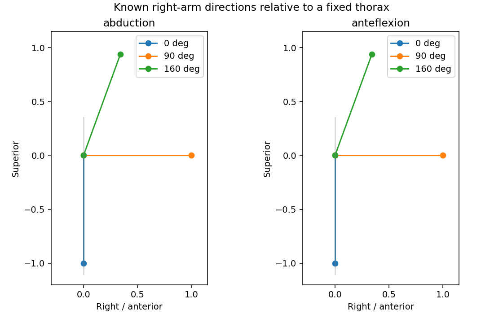
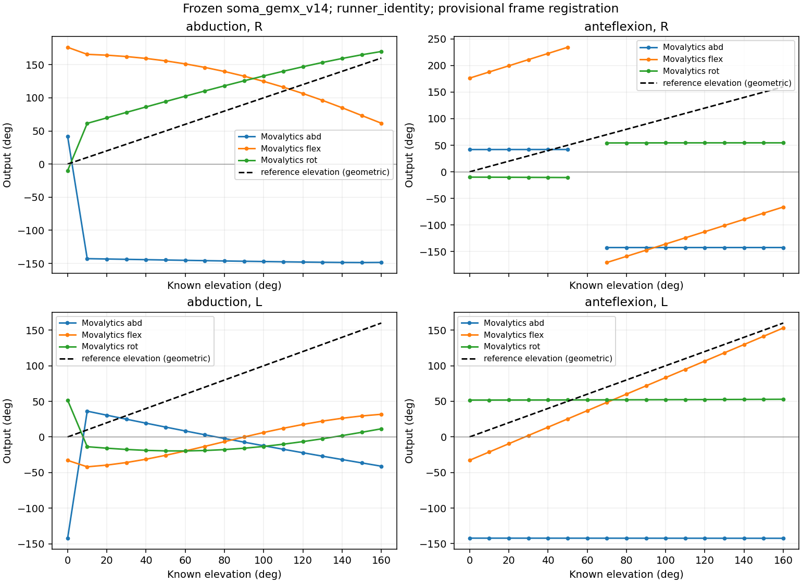
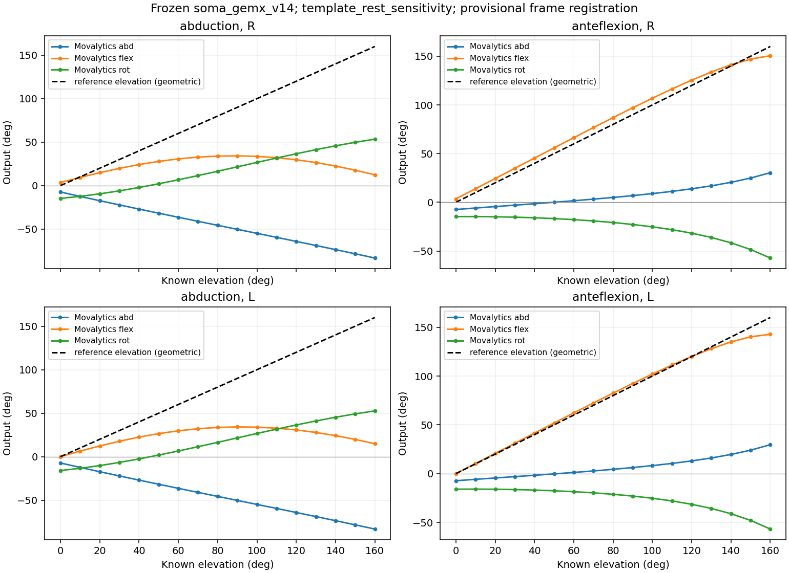

# Controle: bekende schouderheffing van 0 tot 160 graden

**Uitgevoerd zonder GEM-X, zonder filtering en zonder wijziging van de kalibratie.**
De proef levert grote afwijkingen en kanaalvermenging op binnen onze huidige
SOMA-templateaansluiting. Hij reproduceert niet exact de gemelde 160° → 53° en
bewijst nog niet dat alleen de Babon-kalibratie de oorzaak is. De registratie
van onze bovenarmassen op SOMA is nog geen anatomisch gevalideerde registratie.

## Welke standen zijn gemaakt?



Het model gebruikt X naar rechts, Y naar voren en Z omhoog. De neutrale arm
wijst recht naar beneden (-Z), met een verticale borstkas. Twee afzonderlijke
reeksen van 0, 10, …, 160 graden worden gemaakt:

- **Abductie:** uitsluitend een rotatie rond de voor-achteras (-Y rechts,
  +Y links). De arm blijft exact in het frontale vlak.
- **Anteflexie:** uitsluitend een rotatie rond +X. De arm blijft exact in
  het sagittale vlak.

Er wordt geen extra draaiing om de lengteas toegevoegd. Dit is een expliciete
geometrische definitie van 'de andere bewegingen nul', geen claim dat alle
mogelijk gekozen Euler-hoekdefinities dezelfde getallen opleveren. We gebruiken
hier niet de plane/elevation/axial-parameterisatie uit de pitch. Beide proeven
beginnen met exact dezelfde neutrale bovenarmoriëntatie.

Beide armen worden gecontroleerd. De volledige proef wordt herhaald met
borstkas en armen samen 60° gedraaid in de ruimte; de gewrichtsstanden blijven
hierbij gelijk. Er is geen film, mesh of beeldschattingsmodel bij deze proef nodig.

## Primaire uitvoer: rustmatrices zoals in de openbare GEM-X-runner

De bekende oriëntaties worden met onze bestaande template-registratie naar
SOMA-segmentframes omgezet. Daarna wordt de ongewijzigde publieke
`extract_clinical_angles` gebruikt, met `soma_gemx_v14` en identiteitsrustmatrices,
zoals de openbare runner voorschrijft. De onderstaande waarden zijn de
**letterlijke uitvoer**, inclusief tekens, zonder nulstelling of herschaling.
De kolom `abd` hoort in de kalibratie bij de DOF `adduction`; een minteken alleen
is daarom op zichzelf geen bewijs van een fout.

| Bekende stand | Arm | Movalytics abd | Movalytics flex | Movalytics rot |
|---|---|---:|---:|---:|
| Arm langs lijf | R | 41.9° | 176.3° | -10.0° |
| 160° abductie | R | -148.5° | 61.7° | 169.9° |
| Arm langs lijf | L | -142.3° | -32.8° | 51.8° |
| 160° abductie | L | -41.0° | 31.9° | 11.5° |
| 160° anteflexie | R | -142.5° | -66.2° | 54.5° |
| 160° anteflexie | L | -142.5° | 153.1° | 52.9° |



De zwarte stippellijn toont alleen de bekende **geometrische armheffing**, niet
het verwachte verloop van elk van de drie Movalytics-kanalen. De blauwe,
oranje en groene lijnen zijn de letterlijke kanaaluitvoer. Scherpe sprongen
moeten als representatie-/decompositieverschijnsel worden onderzocht, niet als
een echte sprong van de arm.

## Afzonderlijke gevoeligheidscontrole: echte template-rustmatrices

Hier veranderen alleen de ingevoerde rustmatrices: de echte SOMA-template-
oriëntaties vervangen de identiteitsmatrices. Dezelfde kalibratie blijft gelden.
**Dit is geen vastgestelde reparatie en geen aanbevolen nieuwe kalibratie.**
Het laat zien hoeveel invloed de rustconventie heeft op deze aansluiting.

| Bekende stand | Arm | Movalytics abd | Movalytics flex | Movalytics rot |
|---|---|---:|---:|---:|
| Arm langs lijf | R | -7.4° | 3.6° | -14.7° |
| 160° abductie | R | -83.3° | 12.3° | 53.4° |
| Arm langs lijf | L | -7.3° | 0.0° | -15.9° |
| 160° abductie | L | -83.2° | 14.9° | 52.6° |
| 160° anteflexie | R | 30.4° | 150.5° | -57.2° |
| 160° anteflexie | L | 29.6° | 142.8° | -56.8° |



## Wat kunnen we concluderen?

1. **De ingestelde geometrie is gecontroleerd.** Onafhankelijke terugrekening
   bevestigt de opgegeven 0–160° en het juiste bewegingsvlak. Registratie en
   terugregistratie behouden de bekende rotaties.
2. **GEM-X veroorzaakt deze uitkomsten niet:** het is niet uitgevoerd.
3. **Dit is geen zuivere vaststelling van een kalibratiefout.** Naast de
   kalibratie is de voorlopige anatomische aansluiting een mogelijke oorzaak.
   De onverwachte nulstand en links-rechtsverschillen van de primaire proef
   maken dat onderscheid noodzakelijk.
4. **Een factor 160/53 toepassen is niet gerechtvaardigd.** De uitkomsten
   hangen af van richting, zijde, rustconventie en hoekbereik. Een enkele
   vermenigvuldigingsfactor herstelt die verschillen niet vanzelf.
5. **De onderzochte bundeladapter wordt hier overgeslagen.** Deze proef
   gebruikt rechtstreeks de runtime-extractor. Een fout in die adapter kan
   deze directe proef dus niet tijdens het uitvoeren veroorzaken. De herkomst
   van de bestaande kalibratie blijft een afzonderlijk punt.

Het vermoeden van Babon over kalibratie blijft plausibel. Om dat voor de
werkende applicatie vast te stellen hebben we één herkenbare opname nodig met
bijbehorende ruwe segmentrotaties uit die applicatie. Daarmee kunnen we de
werkelijk gebruikte bovenarm- en thoraxframes vergelijken met onze registratie,
en controleren of dezelfde hoekuitvoer reproduceerbaar is. Onze synthetische
controle vervangt die aansluiting nog niet.

## Controles en reproduceerbaarheid

- 272 resultaatregels: twee bewegingen × twee armen × 17 standen × twee ruimterichtingen × twee rustconventies.
- Maximale invloed van gezamenlijke 60° draaiing op de uitvoer: 7.5e-09°.
- Maximale matrixfout bij terugregistratie: 1e-15.
- Twee regels hebben een door Movalytics gemelde lock: rechts 60° anteflexie,
  primaire rustconventie, bij beide ruimterichtingen. De extractor geeft daar
  NaN terug. Die waarden zijn bewaard als ontbrekend, niet geïnterpoleerd.
- Het zijn afzonderlijke statische standen, geen tijdserie van een worp.
  Filtering staat uit zodat een filter deze standen niet met elkaar vermengt.

Bestanden: [alle resultaten](results.csv), [rapport en bronhashes](report.json),
[exacte invoermatrices](inputs.npz), [template-registratie](registration.json).
De invoermatrices en labels zijn eigen gegenereerde data; de SOMA-mesh en
Babon-code/kalibratietabel worden niet meegeleverd.

```bash
.venv/bin/python scripts/check_shoulder_elevation.py \
  --movalytics /tmp/movalytics-review \
  --rig /tmp/soma-pinned-rig.usda \
  --out outputs/shoulder-elevation-new
```

De invoer is vastgelegd op Movalytics-commit
`887de80c8966c1afcd35c5c685b8c59625bf6682` en de geverifieerde SOMA-template.
Er is niets aan kalibratie, tekens of assen gefit om de test te laten slagen.
