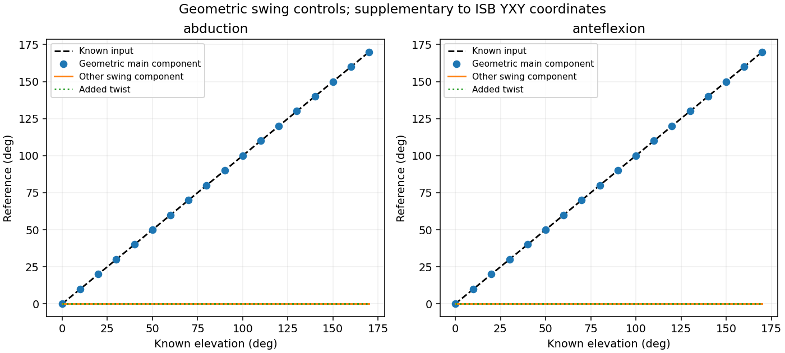
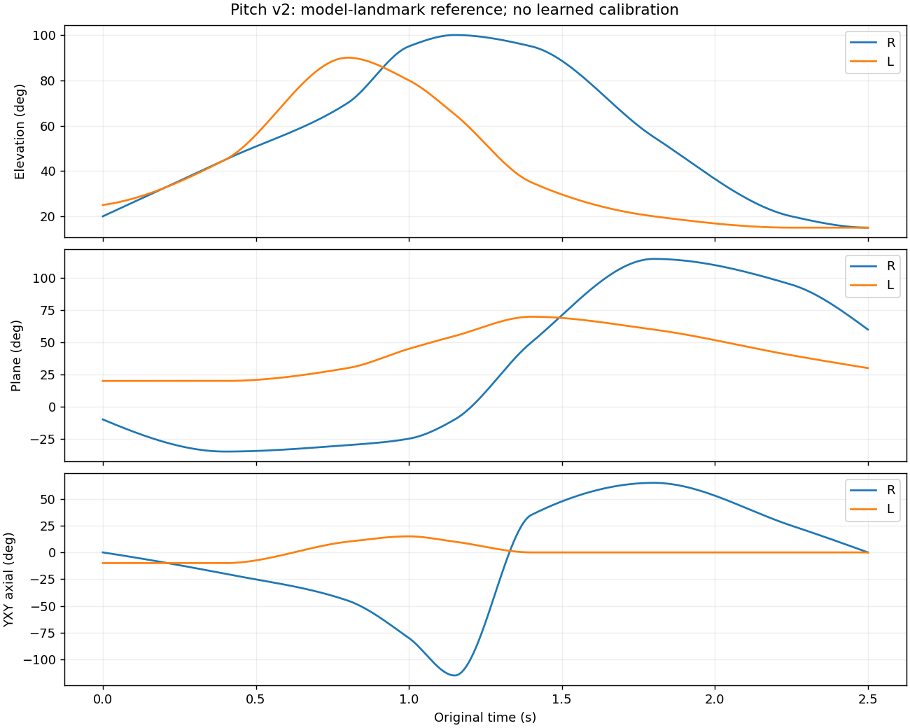

# Geometrische thorax–bovenarmreferentie

**De referentie werkt zonder geleerde kalibratie. Bekende heffingen van 160°
worden voor beide armen als 160° teruggevonden.** De definitie gebruikt
anatomische segmentframes en een vastgelegde Y–X–Y-schouderbeschrijving.

Dit is een numeriek gecontroleerde **modelreferentie**. De landmarks zijn
expliciet ontworpen modelpunten. Er is nog geen validatie op echte mensen en
geen vastgestelde anatomische registratie van GEM-X/SOMA-uitvoer. De bestaande
Movalytics-kalibratie is niet gebruikt of aangepast.

## Wat komt eruit bij de gevraagde standen?

De aanvullende geometrische swingcomponenten maken de zuivere bewegingen
makkelijk herkenbaar. Links en rechts leveren dezelfde waarden op:

| Bekende beweging | Zijwaartse component | Voorwaartse component | Toegevoegde lengteasdraaiing |
|---|---:|---:|---:|
| Arm langs het lichaam, zonder draaiing | 0° | 0° | 0° |
| 160° zuivere abductie | 160° | 0° | 0° |
| 160° zuivere anteflexie | 0° | 160° | 0° |

Deze twee swingcomponenten zijn **aanvullende geometrische grootheden**, geen
claim dat de ISB-schouderdefinitie bestaat uit twee onafhankelijke Euler-hoeken
voor abductie en flexie. Rond volledig verticale armheffing is het vlak niet
uniek bepaald en worden ook deze componenten niet als vastgestelde waarden gegeven.



## De anatomische assen zijn bekend — hun registratie is een andere vraag

De definities liggen vast: X anterior, Y superior voor de thorax en proximaal
voor de bovenarm, Z naar rechts van de persoon. De frames worden opgebouwd uit
anatomische punten:

- **Thorax:** IJ (incisura jugularis), C7, PX (processus xiphoideus), T8.
  Y loopt van het onderste naar het bovenste landmark-midden; de overige assen
  volgen uit het vlak van deze punten en rechtshandige kruisproducten.
- **Bovenarm:** GH (schoudergewrichtscentrum), EL en EM (laterale en mediale
  epicondyl). Y loopt van het epicondylen-midden naar GH. De epicondylen bepalen
  samen met GH de voorwaartse as; links wordt de kruisproductvolgorde omgekeerd
  zodat de segmentframes rechtshandig blijven en Z naar rechts wijst.

De exacte formules staan in [definition.json](definition.json). Alleen de
GH-locatie en de lengterichting van de bovenarm zijn niet genoeg: zonder de
oriëntatie van de epicondylen is axiale rotatie niet vastgelegd.

Een technisch Blender- of SOMA-bot heeft eigen lokale assen. Die worden niet
automatisch anatomisch doordat het bot `RightArm` heet. Onze API accepteert
anatomische frames of expliciete landmarks. Voor technische frames vereist zij
expliciete registratiematrices; er is geen stilzwijgende identiteitsaanname en
geen fit op de gewenste uitvoer.

## Welke ISB-hoeken gebruiken we?

Voor de **thorax–humerusbeweging** wordt de intrinsieke Y–X–Y-beschrijving
gebruikt. Dit is de totale bovenarmoriëntatie ten opzichte van de thorax,
niet uitsluitend de glenohumerale beweging ten opzichte van de scapula.

De drie coördinaten zijn:

1. **Vlak van heffing:** 0° = zuiver zijwaarts, +90° = zuiver voorwaarts.
2. **Heffing:** 0–180°, gemeten ten opzichte van de arm omlaag.
3. **Axiale YXY-hoek:** de derde rotatie in de vastgelegde volgorde.

Rechts geldt, met actieve rotaties op kolomvectoren:

```text
R_anatomisch = R_thorax_world.T @ R_humerus_world
R_anatomisch = Ry(vlak) @ Rx(-heffing) @ Ry(axiale_YXY_hoek)
```

Links wordt een expliciete sagittale spiegelconventie toegepast voor dezelfde
anatomische bewegingsrichting. Het ruwe, fysiek reconstrueerbare YXY-triplet
is links `(-vlak, +heffing, -axiaal)`; rechts `(vlak, -heffing, axiaal)`.
Beide triplets zijn opgeslagen in de programmeerinterface. De CSV gebruikt
zijgenormaliseerde, leesbare waarden. Positieve axiale richting is intern;
de derde hoek blijft een volgorde-afhankelijke Euler-coördinaat.

| Zuivere modelbeweging | Vlak | Heffing | Derde YXY-hoek | Aanvullende minimale-swingdraaiing |
|---|---:|---:|---:|---:|
| 160° abductie zonder extra twist | 0° | 160° | 0° | 0° |
| 160° anteflexie zonder extra twist | 90° | 160° | −90° | 0° |

**Die −90° bij anteflexie is geen gevonden fout of toegevoegde draaiing.**
Bij deze zuivere beweging blijft de epicondylen-as in dezelfde zijwaartse
richting. In de YXY-beschrijving compenseert de derde coördinaat de eerste
rotatie van +90°. De aanvullende grootheid na minimale swing is dan 0°.
Een andere ingestelde YXY-derde hoek zou een andere volledige bovenarmoriëntatie
betekenen, ook als de bovenarm dezelfde richting heeft.

Dit onderscheid is nodig bij een vergelijking met Movalytics: we mogen
`axial_yxy_deg`, `minimal_swing_twist_deg` en een gekalibreerd kanaal met de
naam `rotation` niet zonder definitie als dezelfde grootheid vergelijken.

De aanvullende swingcomponenten zijn `heffing*cos(vlak)` en
`heffing*sin(vlak)`. De minimale-swingdraaiing is de resterende lengteasrotatie
nadat de kortste rotatie van de neutrale bovenarmrichting naar de nieuwe
richting is verwijderd. Het zijn nuttige controles; ze worden niet als extra
onafhankelijke vrijheidsgraden of als vervanging van de ISB-coördinaten verkocht.

## Nulstand en singulariteiten

Bij een arm recht omlaag blijft de volledige bovenarmoriëntatie bekend, maar
kunnen vlak en derde YXY-hoek niet afzonderlijk uniek worden bepaald. De
referentie geeft daarvoor `None`/lege CSV-cellen, plus `singularity=arm_down`.
De gecombineerde lengteasdraaiing is daar wel te bepalen.

Bij een arm recht omhoog worden vlak, derde YXY-hoek én de minimale-swing-
draaiing als onbepaald gemarkeerd. Heffing blijft exact 180°. Bijna verticale
standen krijgen binnen 2° van beide polen een waarschuwing. De numerieke
singulariteitsdrempel is `sin(heffing) <= 1e-8`.

Er worden geen verzonnen nullen, interpolatie of filters gebruikt om dit te
verbergen. De 160°-proeven liggen buiten die singulariteitswaarschuwing.

## Onafhankelijke controles

De referentie gebruikt gesloten matrixformules en landmarkframes met NumPy.
De verificatie gebruikt daarnaast SciPy-rotaties/quaternionen en SciPy's
intrinsieke Euler-ontleding, zonder de formule van onze decoder te hergebruiken.

- **1.592 gestructureerde gevallen:** beide armen, geïsoleerde bewegingen,
  verschillende bewegingsvlakken, gecombineerde heffingen en twists, plus
  gezamenlijk gedraaide en verplaatste lichaamsframes.
- **4.000 willekeurige oriëntaties:** onafhankelijke YXY-ontleding en
  reconstructie van de volledige rotatiematrix.
- **16 poolgevallen:** de onbepaalde hoeken worden expliciet gecontroleerd
  in plaats van met willekeurige verwachte nulwaarden vergeleken.
- Gerichte unittests controleren onder andere 160°-standen, links/rechts,
  romp-/wereldinvariantie, expliciete technische-asregistraties, ongeldige
  rotatiematrices en ontbrekende/degeneratieve landmarks.

De grootste hoekafwijking in de gestructureerde proeven is minder dan
**0,000000002°**. De maximale matrixafwijking bij reconstructie is minder dan
**0,000000000001**. Dit zijn numerieke controles, geen nauwkeurigheidsclaims
voor anatomische landmarks op echte mensen.

Bestanden:

- [Verwachte versus berekende waarden](expected-vs-calculated.csv)
- [Rapport, versies en bronhashes](report.json)
- [Exacte frames en landmarks van alle gestructureerde gevallen](reference-inputs.npz)
- [Volledige hoekdefinitie](definition.json)

## Toegepast op de bestaande pitch

Dezelfde referentie is uitgevoerd op alle **601 frames en beide armen** van
pitch v2: 1.202 labelregels. Daarvoor worden de vastgelegde virtuele landmarks
uit onze eigen rig gebruikt. De volledige bovenarmrotatie kan uit de gevonden
YXY-hoeken terug worden opgebouwd, met matrixafwijkingen onder 1e-14.



[Download de pitchlabels](pitch-reference.csv). Dit zijn originele,
ongefilterde bron-tijdstippen. De beweging, mesh en eerdere video's zijn niet
veranderd. De model-landmarks geven geen klinische validatie van de bestaande
pitchrig of echte personen. GEM-X is voor deze stap niet gebruikt.

## Gebruik

De bibliotheekfunctie vraagt alleen NumPy:

```python
from meshlearning.shoulder_reference import angles_from_landmarks

angles = angles_from_landmarks(
    {"IJ": ij, "C7": c7, "PX": px, "T8": t8,
     "GH": gh, "EL": el, "EM": em},
    side="R",
)
print(angles.elevation_deg)
print(angles.plane_of_elevation_deg)
print(angles.axial_yxy_deg)
```

Heb je al anatomische segmentframes, gebruik dan `angles_from_frames`.
Voor technische frames bestaat `angles_from_registered_segments`, met twee
verplichte matrices waarvan de kolommen de anatomische assen in het technische
segmentframe bevatten. De functie trekt geen technische rustpose af.

De onafhankelijke verificatie gebruikt de extra dependency SciPy. In de
geteste Python 3.12-omgeving zijn NumPy 2.3.5 en SciPy 1.18.1 gebruikt.

```bash
.venv/bin/python -m pip install -c configs/movalytics_cpu_constraints.txt -e '.[review,validation]'
.venv/bin/python scripts/build_shoulder_reference.py \
  --out outputs/shoulder-reference-new \
  --pitch outputs/pitch-v2/motion.npz
.venv/bin/python -m unittest discover -s tests -v
```

Laat `--pitch` weg om alleen de zelfstandige controles uit te voeren. Er is
geen GPU, SOMA-asset, GEM-X of Movalytics-installatie nodig voor deze referentie.

## Bronnen en grenzen

- Wu et al. (2005), *ISB recommendation on definitions of joint coordinate
  systems … Part II: shoulder, elbow, wrist and hand*.
  [DOI: 10.1016/j.jbiomech.2004.05.042](https://doi.org/10.1016/j.jbiomech.2004.05.042).
- Als aanvullende kruiscontrole van de landmark- en YXY-conventies is de
  publieke [Spartacus-documentatie](https://github.com/Spartacus-shoulder-kinematics-dataset/shoulder-kinematics/blob/ec0677cf0b8b7522dd64e44f6e20a0127e412544/README.md#isb-humerus-example)
  gelezen, plus de YXY-keuze en benoeming in `enums_biomech.py` en
  `legend_utils.py`. Er is geen code of dataset uit die repository overgenomen
  of als dependency toegevoegd. De primaire ISB-PDF kon in deze omgeving
  niet rechtstreeks worden opgehaald; de claim blijft daarom een expliciet
  vastgelegde en gecontroleerde modelconventie, geen formele ISB-certificering.

De open vervolgstap is de **werkelijke SOMA-segmentframes anatomisch registreren**
en controleren met applicatie-export. Voor die stap moeten we weten waar de
anatomische assen in de technische rotaties liggen. Een nieuwe
kalibratie leren is daarvoor niet nodig; correcte registraties wel.
